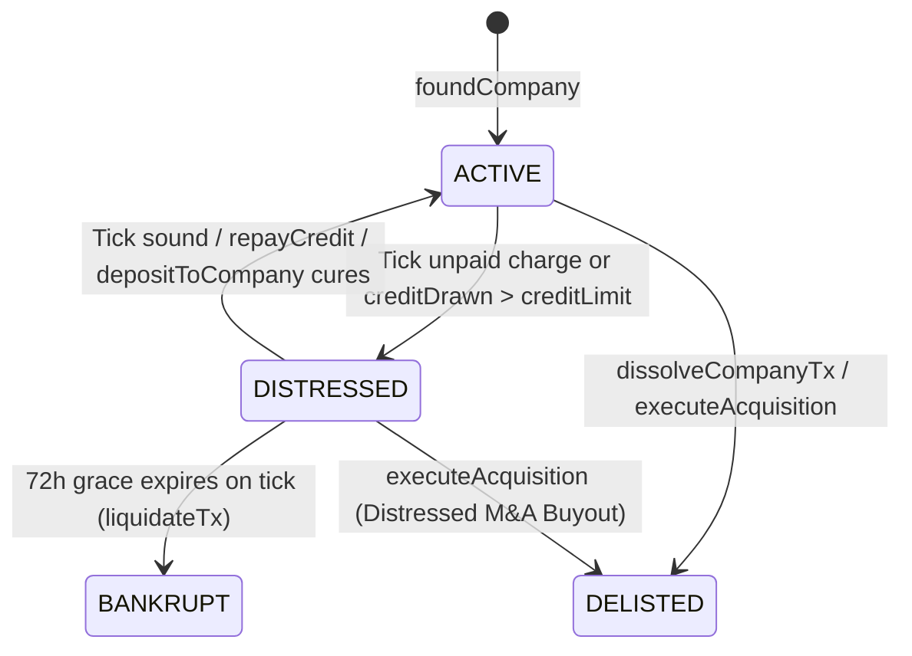

# IxStates State Machines Reference & Concurrency Audit

This document catalogs the **explicit** (enum or string `status` / `state` / `stage` columns) and **implicit** (boolean flags, nullable timestamps, composite columns) state machines across all 15 Prisma schema modules in IxStates, their invariants and transition tables, and the reachable invalid states or transitions discovered and fixed during the state-machine concurrency audit.

---

## 1. Concurrency & Idempotency Taxonomy

Across the codebase, state transitions rely on four server-side concurrency primitives:

1. **Conditional Compare-and-Swap (`updateMany`)**:
   - Transitions filter on the expected current state in the `WHERE` clause (e.g., `where: { id, status: "OPEN" }`) and check `count === 1` before executing side effects (payouts, asset creation, notifications).
2. **Canonical Row-Level Locking (`SELECT ... FOR UPDATE` / `FOR SHARE`)**:
   - Multi-row financial and asset mutations acquire row locks in a deterministic order (e.g., `MyVault` ordered by `userId`, `Company` ordered by `id`, `sport_teams` before `sport_players`) to prevent deadlocks and write skew.
3. **Transaction-Scoped Advisory Locks (`pg_advisory_xact_lock(ns, hashtext(key))`)**:
   - Guards check-then-insert and multi-row aggregation invariants where no single row exists yet to lock (e.g., opening a foreign policy action or directive, or serializing last-member alliance succession).
4. **Unique Idempotency Ledger Keys (`idempotencyKey`)**:
   - Every Sovereign (`ExchangeTransaction`), Treasury (`NationTreasuryEntry`), and Vault (`VaultTransaction`) credit/debit carries a deterministic idempotency key so retries or overlapping cron sweeps execute at most once.

---

## 2. Domain 1 — IxVault & Cards (`prisma/schema/cards.prisma`)

### 2.1 `CardAuction` (`AuctionStatus`) & `CardOwnership.isLocked`
- **States**: `ACTIVE` (initial) | `COMPLETED` (terminal) | `CANCELLED` (terminal) | `EXPIRED` (terminal)
- **Invariants**:
  - While `status === "ACTIVE"`, the auctioned `CardOwnership` row has `isLocked === true`.
  - When an auction reaches any terminal state (`COMPLETED`, `CANCELLED`, `EXPIRED`), `CardOwnership.isLocked` is `false`.
  - `currentBid` increases monotonically; outbid users have their escrowed Vault credits refunded in the same transaction.

| From | To | Trigger (`file:line`) | Guard & Concurrency Mechanism |
| --- | --- | --- | --- |
| *(none)* | `ACTIVE` | `createAuction` (`src/lib/cards/auction-service.ts:45-169`) | `$transaction`; locks `MyVault`, claims `cardOwnership.updateMany({ where: { id, ownerId, isLocked: false }, data: { isLocked: true } })`. |
| `ACTIVE` | `ACTIVE` | `placeBid` (`src/lib/cards/auction-service.ts:174-269`) | `$transaction`; checks `status === "ACTIVE"`, `endsAt > now`, `amount > currentBid`; refunds previous `currentBidderId`. |
| `ACTIVE` | `COMPLETED` | `executeBuyout` (`src/lib/cards/auction-service.ts:274-366`) | `$transaction`; claims `cardAuction.updateMany({ where: { id, status: "ACTIVE" } })`; transfers `CardOwnership` (`isLocked: false`) and credits seller net of 10% fee. |
| `ACTIVE` | `COMPLETED` | `settleAuction` (`src/lib/cards/auction-service.ts:371-480`) | `$transaction` when `currentBidderId !== null`; claims `cardAuction.updateMany({ where: { id, status: "ACTIVE" } })`; transfers card and pays seller. |
| `ACTIVE` | `EXPIRED` | `settleAuction` (`src/lib/cards/auction-service.ts:390-415`) | `$transaction` when `currentBidderId === null`; claims `cardAuction.updateMany({ where: { id, status: "ACTIVE" } })`; unlocks `CardOwnership`. |
| `ACTIVE` | `CANCELLED` | `cancelAuction` (`src/lib/cards/auction-service.ts:485-552`) | `$transaction`; requires `bidCount === 0` and `< 30m` since creation; claims `cardAuction.updateMany({ where: { id, status: "ACTIVE", bidCount: 0 } })`; unlocks card. |

### 2.2 `MarketOrder` (`MarketOrderStatus` & `MarketOrderType`)
- **States**: `OPEN` (initial) | `PARTIALLY_FILLED` | `FILLED` (terminal) | `CANCELLED` (terminal) | `EXPIRED` (terminal)
- **Invariants**:
  - `ASK` orders lock the seller's `CardOwnership` (`isLocked: true`); `BID` orders escrow `price * (quantity - filledQty)` Vault credits.
  - `0 <= filledQty <= quantity`; `status === "FILLED"` iff `filledQty === quantity`.

| From | To | Trigger (`file:line`) | Guard & Concurrency Mechanism |
| --- | --- | --- | --- |
| *(none)* | `OPEN` | `createBid` / `createAsk` (`src/lib/cards/market-service.ts:33-155`) | `$transaction`; locks `MyVault` or claims `cardOwnership.updateMany({ where: { isLocked: false } })`, then invokes `matchOrdersTx`. |
| `OPEN` / `PARTIALLY_FILLED` | `PARTIALLY_FILLED` / `FILLED` | `matchOrdersTx` (`src/lib/cards/market-service.ts:238-385`) | Runs inside creator's `$transaction`; matches crossing `ASK`/`BID` rows in price-time priority, transferring card ownership and refunding price improvement. |
| `OPEN` / `PARTIALLY_FILLED` | `CANCELLED` | `cancelOrder` (`src/lib/cards/market-service.ts:160-212`) | `$transaction`; claims `marketOrder.updateMany({ where: { id, userId, status: { in: ["OPEN", "PARTIALLY_FILLED"] } } })`; unlocks card or refunds remaining bid escrow. |
| `OPEN` / `PARTIALLY_FILLED` | `EXPIRED` | `expireOrders` (`src/lib/cards/market-service.ts:390-445`) | Per-order `$transaction`; claims `status: { in: ["OPEN", "PARTIALLY_FILLED"] }` where `expiresAt <= now`; unlocks card or refunds escrow. |

### 2.3 `P2PTrade` (`TradeStatus`)
- **States**: `PENDING` (initial) | `ACCEPTED` (terminal) | `REJECTED` (terminal) | `CANCELLED` (terminal) | `EXPIRED` (terminal) | `COUNTERED` (terminal)
- **Invariants**:
  - Initiator's offered cards (`isLocked: true`) and credits are escrowed while `status === "PENDING"`.
  - Any terminal transition other than `ACCEPTED` returns escrowed cards (`isLocked: false`) and credits to the initiator.

| From | To | Trigger (`file:line`) | Guard & Concurrency Mechanism |
| --- | --- | --- | --- |
| *(none)* | `PENDING` | `createTradeOffer` (`src/lib/cards/trade-service.ts:42-178`) | `$transaction`; locks initiator `MyVault`, claims `cardOwnership.updateMany({ where: { id: { in: cardIds }, ownerId, isLocked: false } })`. |
| `PENDING` | `ACCEPTED` | `acceptTrade` (`src/lib/cards/trade-service.ts:183-315`) | `$transaction`; locks both vaults in `userId` order; claims `p2PTrade.updateMany({ where: { id, status: "PENDING" } })`; swaps cards and credits. |
| `PENDING` | `REJECTED` | `rejectTrade` (`src/lib/cards/trade-service.ts:320-358`) | `$transaction`; claims `status: "PENDING"`; unlocks initiator cards and refunds initiator credits. |
| `PENDING` | `CANCELLED` | `cancelTrade` (`src/lib/cards/trade-service.ts:363-401`) | `$transaction`; claims `status: "PENDING"`; unlocks initiator cards and refunds initiator credits. |
| `PENDING` | `COUNTERED` | `counterTrade` (`src/lib/cards/trade-service.ts:406-475`) | `$transaction`; claims original trade `PENDING -> COUNTERED`, refunds original initiator, and creates new `PENDING` trade with `parentTradeId`. |
| `PENDING` | `EXPIRED` | `expireTrades` (`src/lib/cards/trade-service.ts:480-520`) | Per-trade `$transaction`; claims `status: "PENDING"` where `expiresAt < now`; unlocks cards and refunds initiator. |

### 2.4 `Card.reviewState` (`CardReviewState`), `CardArtLicence.status`, & `LoreCardRequest.status`
- **`Card.reviewState` States**: `PENDING` (initial for imports) | `APPROVED` | `REJECTED`
- **`CardArtLicence.status` States**: `UNKNOWN` | `CLEAR` | `RESTRICTED`
- **`LoreCardRequest.status` States**: `PENDING` (initial) | `GENERATED` (terminal) | `REJECTED` (terminal)
- **Invariants**:
  - A card with `artLicence.status === "RESTRICTED"` can never transition to `reviewState === "APPROVED"` (`EXCLUDE_RESTRICTED_ART` guard in `src/server/modules/cards/cards.curation.ts:162`).
  - Only `reviewState === "APPROVED"` cards with non-restricted art enter pack pools.

| Machine | From | To | Trigger (`file:line`) | Guard & Concurrency Mechanism |
| --- | --- | --- | --- | --- |
| `Card.reviewState` | `PENDING` / `REJECTED` | `APPROVED` | `reviewCards` (`src/server/modules/cards/cards.curation.ts:149-177`) | `$transaction`; `assertQueueUnchanged` recount + `EXCLUDE_RESTRICTED_ART` filter. |
| `Card.reviewState` | `PENDING` | `REJECTED` | `reviewCards` (`src/server/modules/cards/cards.curation.ts:149-177`) | `$transaction`; updates `reviewState: "PENDING" -> "REJECTED"`. |
| `LoreCardRequest` | `PENDING` | `GENERATED` | `acceptSuggestion` (`src/server/modules/cards/cards.curation.ts:213-260`) | Stages card via `stageForAdmin` (enforces unique `(wikiArticleTitle, wikiSource)`), then updates request in `$transaction`. |
| `LoreCardRequest` | `PENDING` | `REJECTED` | `declineSuggestion` (`src/server/modules/cards/cards.curation.ts:262-285`) | `$transaction`; claims `loreCardRequest.updateMany({ where: { id, status: "PENDING" } })`. |

### 2.5 Implicit Vault State Machines (`PackPurchase.isOpened` & `JunkLock`)
- **`PackPurchase.isOpened`**: `false` (initial on `purchasePack`) -> `true` (terminal on `openPack` in `src/lib/cards/pack-service.ts:232-310`, guarded by `packPurchase.updateMany({ where: { id, userId, isOpened: false }, data: { isOpened: true } })`).
- **`JunkLock` / `CardOwnership` Junking**: `junkCards` (`src/server/api/routers/vault/junk.ts`) deletes `CardOwnership` rows matching `{ id: { in: ownershipIds }, ownerId, isLocked: false }` and excludes any ownership row present in `JunkLock` or `CardDeckCard`.

---

## 3. Domain 2 — Corporate Exchange (`prisma/schema/exchange.prisma`)

### 3.1 `Company` Lifecycle (`status`, `distressedSinceIxTime`, `tradingOpen`)
- **States**: `ACTIVE` (initial) | `DISTRESSED` | `BANKRUPT` (terminal) | `DELISTED` (terminal)
- **Invariants**:
  - `ACTIVE`: `distressedSinceIxTime === null`.
  - `DISTRESSED`: `distressedSinceIxTime !== null`; company may still trade, operate, deposit capital, or repay its credit line, and may be bought out via M&A (`ACQUIRE`), but cannot draw new credit (`borrowCredit`).
  - `BANKRUPT` / `DELISTED`: `capital === 0`, `creditDrawn === 0`, `decisionValue === 0`, `standing === 0`, `contractsWonValue === 0`, `tradingOpen === false`, no `OPEN` `ShareListing`, `ShareBuyOrder`, or `CompanyProposal` rows.

| From | To | Trigger (`file:line`) | Guard & Concurrency Mechanism |
| --- | --- | --- | --- |
| *(none)* | `ACTIVE` | `foundCompany` (`src/lib/exchange/companies.ts:186-269`) | `$transaction`; locks founder wallet, enforces `activeCompanyCap` and realm charter rules. |
| `ACTIVE` | `DISTRESSED` | `applyDistressTx` (`src/lib/exchange/distress.ts:100-131`) | Realm tick `$transaction`; `setStatusTx(tx, id, "ACTIVE", { status: "DISTRESSED", distressedSinceIxTime: nowMs })`. |
| `DISTRESSED` | `ACTIVE` | `applyDistressTx` (`src/lib/exchange/distress.ts:132-146`), `repayCredit` (`src/lib/exchange/credit.ts:224-239`), `depositToCompany` (`src/lib/exchange/companies.ts:318-333`) | `lockCompany`; transitions to `ACTIVE` with `distressedSinceIxTime: null` when `capital >= 0` and `creditDrawn <= creditLimit`. |
| `DISTRESSED` | `BANKRUPT` | `liquidateTx` (`src/lib/exchange/distress.ts:226-256`) | Realm tick `$transaction` after `72h` grace (`DISTRESS_GRACE_MS`); cancels share listings/buy orders/open proposals, recovers 40% plant from HQ treasury, repays lender, pays holders pro rata, and claims `setStatusTx(tx, id, "DISTRESSED", { status: "BANKRUPT", ... })`. |
| `ACTIVE` | `DELISTED` | `dissolveCompanyTx` (`src/lib/exchange/companies.ts:413-489`) | `lockCompany`; requires `creditDrawn === 0`, no live contracts, no pending decisions; cancels bids/listings/buy orders/open proposals, claims `company.updateMany({ where: { id, status: "ACTIVE", capital } })`, and splits capital pro rata. |
| `ACTIVE` / `DISTRESSED` | `DELISTED` | `executeAcquisition` (`src/lib/exchange/acquisition.ts:148-216`) | Locks target then buyer; repays credit line, cancels listings/buy orders/open proposals, distributes proceeds to target holders, transfers plant/standing to buyer, and claims `company.updateMany({ where: { id, status: { in: ["ACTIVE", "DISTRESSED"] } } })`. |

### 3.2 `Contract` (`status`) & `ContractBid` (`outcome`)
- **`Contract.status` States**: `OPEN` (initial) | `AWARDED` | `DISPUTED` | `COMPLETED` (terminal) | `CANCELLED` (terminal)
- **`ContractBid.outcome` States**: `null` (initial pending) | `"WON"` (terminal) | `"LOST"` (terminal)
- **Invariants**:
  - While `status` is `OPEN`, `AWARDED`, or `DISPUTED`, `escrow > 0`.
  - When `status` transitions to `COMPLETED` or `CANCELLED`, `escrow === 0` and `closedIxTime !== null`.
  - Every `transition(tx, id, from, to, extra)` in `src/lib/exchange/contracts.ts:62-84` uses `contract.updateMany({ where: { id, status: from } })` and throws `CONFLICT` if `count !== 1`.

| From | To | Trigger (`file:line`) | Guard & Concurrency Mechanism |
| --- | --- | --- | --- |
| *(none)* | `OPEN` | `createContract` (`src/lib/exchange/contracts.ts:195-275`), `generateGovernmentTenders` (`src/lib/exchange/tenders.ts:140-220`) | `$transaction`; debits issuer company capital, wallet, or nation treasury into `escrow`. |
| `OPEN` | `AWARDED` | `awardContract` (`src/lib/exchange/contracts.ts:421-485`) | `$transaction`; `transition(tx, id, "OPEN", "AWARDED", ...)`; refunds `(escrow - bid.amount)` to issuer; marks winning bid `"WON"` and other bids `"LOST"`. |
| `OPEN` | `CANCELLED` | `cancelContract` (`src/lib/exchange/contracts.ts:490-530`), `expireLapsedContracts` (`src/lib/exchange/expiry.ts:32-96`) | `$transaction`; `transition(tx, id, "OPEN", "CANCELLED", { escrow: 0 })`; marks bids `"LOST"` and calls `refundIssuer`. |
| `AWARDED` | `COMPLETED` | `completeContract` (`src/lib/exchange/contracts.ts:535-580`) | `$transaction`; `transition(tx, id, "AWARDED", "COMPLETED", { escrow: 0 })`; calls `payContractor` (verifies contractor is `ACTIVE` or `DISTRESSED`). |
| `AWARDED` | `DISPUTED` | `disputeContract` (`src/lib/exchange/contracts.ts:585-635`) | `$transaction`; `transition(tx, id, "AWARDED", "DISPUTED", ...)`. |
| `DISPUTED` | `COMPLETED` / `CANCELLED` | `resolveDispute` (`src/lib/exchange/contracts.ts:640-700`) | `$transaction`; `transition(tx, id, "DISPUTED", to, { escrow: 0 })`; pays contractor or refunds issuer (falling back to founder wallet if issuer company is `BANKRUPT`/`DELISTED`). |

### 3.3 `ShareListing` (`status`) & `ShareBuyOrder` (`status`)
- **States**: `OPEN` (initial) | `FILLED` (terminal) | `CANCELLED` (terminal)
- **Transitions**:
  - `listSharesForSale` / `issueSharesTx` (`src/lib/exchange/shares.ts:105-210`): creates `OPEN` `ShareListing` (escrowing seller's shares from `Shareholding` or offering primary shares with `sellerUserId: null`) and matches resting `OPEN` `ShareBuyOrder`s.
  - `placeBuyOrder` / `buyShares` (`src/lib/exchange/shares.ts:310-490`): matches `OPEN` listings in price-time order under `lockCompany`, transitioning fully matched orders/listings to `FILLED`.
  - `cancelShareListing` / `cancelBuyOrder` (`src/lib/exchange/shares.ts:270-305, 495-530`) and `returnListedShares` / `returnBuyOrders`: claim `status: "OPEN" -> "CANCELLED"` and return escrowed shares or Sovereigns.

### 3.4 `CompanyProposal` (`status`) & `CompanyDecision` (`appliedIxTime`)
- **`CompanyProposal.status` States**: `OPEN` (initial) | `PASSED` (terminal) | `REJECTED` (terminal) | `EXPIRED` (terminal)
- **`CompanyDecision` Implicit States**: `appliedIxTime === null` (pending) -> `appliedIxTime !== null && effect.rejected === undefined` (applied) | `appliedIxTime !== null && effect.rejected !== undefined` (rejected & refunded)
- **Invariants**:
  - At most one `OPEN` owner proposal of a given `type` (`DISSOLVE` or `ISSUE_SHARES`) per company.
  - `tallyOf` (`src/lib/exchange/governance.ts:93-112`) weights every ballot by the voter's **current** eligible shares from `holdersOf(tx, companyId)`, preventing share-transfer vote multiplication.
  - Passing threshold: `sharesFor * 2 > sharesOutstanding`; rejection threshold: `sharesAgainst * 2 >= sharesOutstanding`.

| Machine | From | To | Trigger (`file:line`) | Guard & Concurrency Mechanism |
| --- | --- | --- | --- | --- |
| `CompanyProposal` | *(none)* | `OPEN` (or `PASSED`) | `openProposal` (`src/lib/exchange/governance.ts:240-269`), `resolveAcquireDecision` (`src/lib/exchange/governance.ts:344-388`) | `lockCompany`; creates `OPEN` proposal and immediately runs `settleTx` (fast-pathing to `PASSED` if proposer holds `> 50%`). |
| `CompanyProposal` | `OPEN` | `OPEN` / `PASSED` / `REJECTED` | `castVote` (`src/lib/exchange/governance.ts:282-310`) | `lockCompany`; records ballot, recomputes live holder-weighted `tallyOf`, claims `companyProposal.updateMany({ where: { id, status: "OPEN" } })`, and executes `executeTx` or `closeTx` in the same transaction. |
| `CompanyProposal` | `OPEN` | `EXPIRED` | `finalizeProposalsTx` (`src/lib/exchange/governance.ts:316-337`), `closeCompanyProposalsTx` (`src/lib/exchange/acquisition.ts:126-150`) | `lockCompany`; claims `status: "OPEN" -> "EXPIRED"` and refunds any `ACQUIRE_OFFER` escrow via `returnOfferTx`. |
| `CompanyDecision` | `appliedIxTime: null` | `appliedIxTime: now` | `resolveDueDecisions` (`src/lib/exchange/decisions.ts:285-355`) | Per-decision `$transaction`; locks company, claims `companyDecision.updateMany({ where: { id, appliedIxTime: null } })`, applies plant/pivot/lobby/rebrand or opens `ACQUIRE_OFFER`. |

---

## 4. Domain 3 — Sports & MyClub (`prisma/schema/sports.prisma`)

### 4.1 `SportSeason` (`status` & `activeStage`)
- **States**: `"upcoming"` (initial) | `"in_progress"` (with `activeStage = 1..N`) | `"completed"` (terminal)
- **Invariants**:
  - `activeStage` only advances from `k` to `k + 1` when Stage `k` has `0` remaining `"scheduled"` matches and `0` remaining `"scheduled"` brackets (`src/lib/sports/transition.ts:911-935`).
  - A `"completed"` season can be transitioned by `transitionSeasonAction` at most once (`src/lib/sports/transition.ts:426-432, 492-498`).

| From | To | Trigger (`file:line`) | Guard & Concurrency Mechanism |
| --- | --- | --- | --- |
| *(none)* | `"upcoming"` | `createSeason` (`src/server/api/routers/sports/seasons/lifecycle.ts:42-95`) | Commissioner auth; creates season at `seasonNumber`. |
| `"upcoming"` | `"in_progress"` | `startSeason` (`src/server/api/routers/sports/seasons/lifecycle.ts:98-185`) | Generates standings (`SportStanding`) and stage-1 schedule (`persistSeasonSchedule`). |
| `"in_progress"` (stage $k$) | `"in_progress"` (stage $k+1$) | `transitionToNextStage` (`src/lib/sports/stage-transition.ts:81-170`) | Requires `remainingMatches === 0 && remainingBrackets === 0` in stage $k$; atomically claims `sportSeason.updateMany({ where: { id, activeStage: currentStageId }, data: { activeStage: nextStage.id } })` before creating next-stage brackets/matches. |
| `"in_progress"` | `"completed"` | `completeSeason` (`src/lib/sports/season-cron.ts:124-182`), `simulateFullSeason` (`src/server/api/routers/sports/seasons/fullseason.ts:175-265`) | Crowns `championTeamId`, updates historical records, and invokes `transitionSeasonAction`. |
| `"completed"` (Season $N$) | Season $N+1$ `"in_progress"` | `transitionSeasonAction` (`src/lib/sports/transition.ts:422-675`) | `$transaction`; verifies no season $> N$ exists; ages players/coaches, cancels retired players' transfer listings and refunds pending bids, swaps promoted/relegated clubs, deducts wages, drafts rookies, schedules Season $N+1$, and mints trophy card. |
| `"in_progress"` / `"completed"` | `"upcoming"` | `resetSeason` (`src/server/api/routers/sports/leagues/schedule.ts:82-116`) | Refunds open predictions under match row locks (`refundOpenPredictionsTx`), deletes matches/standings/brackets/races, resets `activeStage: 1`. |

### 4.2 `SportMatch` (`status` & Revenue Collection) & `SportPrediction` (`status`)
- **`SportMatch.status` States**: `"scheduled"` (initial) | `"completed"` (terminal)
- **`SportMatch` Revenue Implicit States**: `homeRevenueCollectedAt: null -> Date`, `awayRevenueCollectedAt: null -> Date`
- **`SportPrediction.status` States**: `"open"` (initial) | `"won"` (terminal) | `"lost"` (terminal) | `"void"` (terminal)
- **Invariants**:
  - Whenever a `SportMatch` transitions `"scheduled" -> "completed"` (via `simulateAndPersistMatch`, `simulateFullSeason`, or `overrideMatchResult`), `resolveMatchPredictions` settles all `"open"` predictions on that match.
  - Whenever `"scheduled"` matches are deleted (`resetSeason`, `generateSchedule`, `deleteLeague`), `refundOpenPredictionsTx` locks the matches and refunds all `"open"` predictions as `"void"`.

| Machine | From | To | Trigger (`file:line`) | Guard & Concurrency Mechanism |
| --- | --- | --- | --- | --- |
| `SportMatch` | `"scheduled"` | `"completed"` | `simulateAndPersistMatch` (`src/lib/sports/simulate-and-persist.ts:62-175`) | `$transaction`; claims `sportMatch.updateMany({ where: { id, status: "scheduled" } })`; updates `SportStanding` only if `claimed.count === 1`, then calls `resolveMatchPredictions`. |
| `SportMatch` | `"scheduled"` / `"completed"` | `"completed"` | `overrideMatchResult` (`src/server/api/routers/sports/leagues/schedule.ts:119-160`) | Updates match scores/status, rebuilds standings from scratch (`recalculateStandings`), and settles any open predictions (`resolveMatchPredictions`). |
| `SportMatch` Revenue | `null` | `Date` | `collectMatchRevenue` (`src/server/api/routers/sports/seasons/lifecycle.ts:390-465`) | `$transaction`; locks club (`SELECT ... FOR UPDATE`), claims `homeRevenueCollectedAt: null` / `awayRevenueCollectedAt: null`, credits club budget once. |
| `SportPrediction` | *(none)* | `"open"` | `placePrediction` (`src/server/api/routers/sports/predictions.ts:66-140`) | Requires `match.status === "scheduled"` and `now < scheduledIxTime`; debits stake via `exchangeService.spend` (`PREDICTION_STAKE:<matchId>`). |
| `SportPrediction` | `"open"` | `"won"` / `"lost"` / `"void"` | `resolveMatchPredictions` (`src/lib/sports/predictions.ts:57-155`) | Claims each prediction via `sportPrediction.updateMany({ where: { id, status: "open" } })`; pays parimutuel winners (`PREDICTION_WIN:<id>`) or refunds pool as `"void"` (`PREDICTION_REFUND:<id>`) when `winningPool === 0`. |

### 4.3 `SportTransferListing` (`status`) & `SportTransferBid` (`status`)
- **`SportTransferListing.status` States**: `"open"` (initial) | `"completed"` (terminal) | `"cancelled"` (terminal)
- **`SportTransferBid.status` States**: `"pending"` (initial) | `"accepted"` (terminal) | `"rejected"` (terminal) | `"expired"` (terminal)
- **Invariants**:
  - Only active, non-retired players (`isActive === true && careerStage !== "retired"`) can be listed.
  - Lock hierarchy: `lockTransferClub` (`FOR SHARE`) before `lockTransferPlayer` (`FOR UPDATE`).

| Machine | From | To | Trigger (`file:line`) | Guard & Concurrency Mechanism |
| --- | --- | --- | --- | --- |
| `SportTransferListing` | *(none)* / closed | `"open"` | `listPlayerForTransfer` (`src/server/api/routers/sports/transfers.ts:33-68`) | `$transaction`; `lockTransferPlayer`; verifies `player.isActive && player.careerStage !== "retired"`. |
| `SportTransferBid` | *(none)* | `"pending"` | `placeTransferBid` (`src/server/api/routers/sports/transfers.ts:70-145`) | `$transaction`; `lockTransferClub` + `lockTransferPlayer`; escrows Sovereigns (`TRANSFER_BID_ESCROW:<listingId>`). |
| `SportTransferBid` + `Listing` | `"pending"` / `"open"` | `"accepted"` / `"completed"` | `respondToTransferBid(accept)` (`src/server/api/routers/sports/transfers.ts:148-255`) | `$transaction`; locks club + player; claims bid `"pending" -> "accepted"`, closes listing `"completed"`, moves player to buyer club, pays seller (`TRANSFER_SALE:<bidId>`), and refunds all other `"pending"` bids via `refundTransferBidTx`. |
| `SportTransferBid` | `"pending"` | `"rejected"` / `"expired"` | `respondToTransferBid(reject)`, `deleteLeague` (`crud.ts:275`), retirement (`transition.ts:503-544`) | Claims `sportTransferBid.updateMany({ where: { id, status: "pending" } })` and refunds bidder (`TRANSFER_BID_REFUND:<bidId>`). |

### 4.4 `SportRace`, `SportBracket`, `SportPlayer` Career, `SportTournament` & `SportMatchSeries`
- **`SportRace.status`**: `"upcoming"` (initial) -> `"qualifying_complete"` (`advanceCircuitQualifying` in `src/lib/sports/season-cron.ts:330-368`) -> `"completed"` (`advanceCircuitRace` in `season-cron.ts:370-425` and `simulateCircuitSeason` in `fullseason.ts:25-54`, both guarded by `sportRace.updateMany({ where: { id, status: { in: ["upcoming", "qualifying_complete"] } } })`).
- **`SportBracket.status`**: `"scheduled"` (initial) -> `"completed"` (`advanceBracketRound` in `season-cron.ts:428-520` and `simulateStageBrackets` in `fullseason.ts:112-172`).
- **`SportPlayer.careerStage` & `isActive`**: `"rookie"` -> `"developing"` -> `"prime"` -> `"veteran"` -> `"declining"` -> `"retired"` (`isActive: false` via `processAging` in `src/lib/sports/aging.ts` and `updateAged` in `src/lib/sports/transition.ts:164-192`).

---

## 5. Domain 4 — Diplomacy, Intelligence & Military (`prisma/schema/diplomacy.prisma`, `military.prisma`, `intelligence.prisma`)

### 5.1 `AllianceMember` (`status`, `isActive`, `role`) & Alliance Succession
- **States**: `"invited"` (`isActive: false`) | `"active"` (`isActive: true`) | `"declined"` (`isActive: false`) | `"withdrawn"` (`isActive: false`) | `"left"` (`isActive: false`) | `"removed"` (`isActive: false`)
- **Invariants**:
  - Every surviving `Alliance` has `memberCount >= 1` and exactly one active member with `role === "founder"`.
  - Stale `"invited"` rows expire after 14 real days (`PROPOSAL_TTL_MS` in `src/lib/diplomacy/proposal-lifecycle.ts`).

| From | To | Trigger (`file:line`) | Guard & Concurrency Mechanism |
| --- | --- | --- | --- |
| *(none)* / inactive | `"invited"` (`isActive: false`) | `inviteMember` (`src/server/api/routers/diplomacy/policies/alliances.ts:305-415`) | Uses conditional `allianceMember.updateMany({ where: { id: existing.id, isActive: false, status: existing.status } })` when re-inviting so an active membership can never be overwritten. |
| `"invited"` | `"active"` (`isActive: true`) | `respondToAllianceInvite(accept)` (`src/server/api/routers/diplomacy/policies/alliance-invites.ts:45-135`) | `$transaction`; claims `allianceMember.updateMany({ where: { id, status: "invited", isActive: false } })` and increments `alliance.memberCount`. |
| `"invited"` | `"declined"` / `"withdrawn"` | `respondToAllianceInvite(decline)` / `withdrawAllianceInvite` (`alliance-invites.ts:80-175`) | Claims `allianceMember.updateMany({ where: { id, status: "invited", isActive: false } })`. |
| `"active"` | `"left"` (`isActive: false`) | `leaveAllianceMembership` (`src/lib/diplomacy/alliance-succession.ts:16-54`) | `$transaction` with `pg_advisory_xact_lock(7201, hashtext(allianceId))`; claims `isActive: true -> false`, deletes alliance if `remaining.length === 0`, or promotes earliest-joined active member to `"founder"`. |
| `"active"` | `"removed"` (`isActive: false`) | `removeMember` (`src/server/api/routers/diplomacy/policies/alliances.ts:455-515`) | Founder/leader removes non-founder member and decrements `memberCount`. |

### 5.2 `ForeignPolicyAction` (`status`)
- **States**: `"proposed"` (initial for cooperative: `free_trade`, `military_alliance`) | `"active"` (initial for hostile: `embargo`, `sanctions`, `border_closure`, `denounce`; or accepted cooperative) | `"lifted"` (terminal) | `"declined"` (terminal) | `"withdrawn"` (terminal) | `"expired"` (terminal)
- **Invariants**:
  - At most one `"proposed"` or `"active"` action per `(initiatorId, targetId, actionType)` for unilateral hostile actions, and at most one per unordered pair `{countryA, countryB}` for symmetric cooperative actions (`free_trade`, `military_alliance`).
  - `StorytellerEffect` rows created while `"active"` are keyed by `foreignPolicyEffectKey(action.id)` and ended atomically when transitioning `"active" -> "lifted"`.

| From | To | Trigger (`file:line`) | Guard & Concurrency Mechanism |
| --- | --- | --- | --- |
| *(none)* | `"proposed"` / `"active"` | `openForeignPolicyAction` (`src/server/api/routers/diplomacy/policies/foreignPolicy.ts:272-395`) | `$transaction` with `pg_advisory_xact_lock(4102, hashtext(pairLockKey))`; checks bidirectional `OR` for cooperative actions and unidirectional for hostile actions. |
| `"proposed"` | `"active"` / `"declined"` | `respondToForeignPolicyProposal` (`src/server/api/routers/diplomacy/policies/foreignPolicy.ts:460-545`) | Claims `foreignPolicyAction.updateMany({ where: { id, status: "proposed" } })`; applies GDP storyteller effects only if `claimed.count === 1`. |
| `"proposed"` | `"withdrawn"` / `"expired"` | `withdrawForeignPolicyProposal` (`foreignPolicy.ts:550-585`), stale sweep (`foreignPolicy.ts:75-95`) | Claims `status: "proposed" -> "withdrawn" / "expired"`. |
| `"active"` | `"lifted"` | `endForeignPolicyAction` (`src/lib/diplomacy/foreign-policy-effects.ts:110-155`) | Claims `foreignPolicyAction.updateMany({ where: { id, status: "active" } })`; ends `StorytellerEffect` rows matching `foreignPolicyEffectKey(id)` when `claimed.count === 1`. |

### 5.3 `Treaty`, `DiplomaticMission`, `CulturalExchange`, `AllianceAction` & `CrisisEvent`
- **`Treaty.status`**: `"draft"` -> `"ACTIVE"` (`createTreaty` / `ratifyTreaty` in `src/server/api/routers/diplomacy/treaties.ts`) -> `"EXPIRED"` / `"TERMINATED"`.
- **`DiplomaticMission.status`**: `"proposed"` -> `"active"` / `"declined"` / `"withdrawn"` / `"expired"` -> `"suspended"` / `"closed"` (`src/server/api/routers/diplomacy/embassies/missions.ts`).
- **`CulturalExchange.status`**: `"planning"` -> `"active"` / `"declined"` / `"withdrawn"` / `"expired"` -> `"completed"` / `"cancelled"` (`src/server/api/routers/diplomacy/cultural/programs.ts`).
- **`AllianceAction.status`**: `"proposed"` -> `"approved"` -> `"executed"` | `"rejected"` | `"expired"` (`src/server/api/routers/diplomacy/policies/alliance-actions.ts`).
- **`CrisisEvent.responseStatus`**: `"pending"` -> `"monitoring"` / `"responding"` -> `"resolved"` / `"ignored"` (`src/server/api/routers/diplomacy/crises.ts`).

### 5.4 Military Conflicts, Operations & Procurement (`prisma/schema/military.prisma`)
- **`MilitaryConflict.status`**: `"proposed"` (initial PvP) | `"active"` (initial PvNPC or accepted PvP) | `"resolved"` (terminal, with `winner` set to country ID or `"declined"` / `"withdrawn"` / `"expired"`).
- **`MilitaryOperation.status` & `Deployment.status`**:
  - `MilitaryOperation.status`: `"planned"` / `"active"` -> `"completed"` / `"cancelled"`.
  - `Deployment.status`: `"deployed"` -> `"recalled"`.
- **`ProcurementOrder.status`**: `"ordered"` (initial) -> `"delivered"` (terminal) | `"cancelled"` (terminal).

| Machine | From | To | Trigger (`file:line`) | Guard & Concurrency Mechanism |
| --- | --- | --- | --- | --- |
| `MilitaryConflict` (PvP) | *(none)* | `"proposed"` | `proposePvPConflict` (`src/server/api/routers/security/conflicts/pvp.ts:34-172`) | Expires stale proposals (`stalePvPProposalsBetween`), checks no `"proposed"`/`"active"` conflict exists between pair. |
| `MilitaryConflict` (PvP) | `"proposed"` | `"active"` / `"resolved"` (`declined`) | `respondToConflict` (`src/server/api/routers/security/conflicts/pvp.ts:176-330`) | Claims `militaryConflict.updateMany({ where: { id, status: "proposed" } })` before sealing battle seed (`sealPvP`) or recording decline. |
| `MilitaryConflict` (PvP) | `"proposed"` | `"resolved"` (`withdrawn`) | `withdrawPvPConflict` (`src/server/api/routers/security/conflicts/pvp.ts:333-355`) | Claims `militaryConflict.updateMany({ where: { id, status: "proposed" } })`. |
| `MilitaryConflict` (PvP) | `"active"` | `"resolved"` | `concludePvPConflict` (`pvp.ts:360-440` -> `concludePvP` in `src/server/modules/combat/combat.service.ts:248-305`) | Verifies duration elapsed on realm clock; claims `militaryConflict.updateMany({ where: { id, status: "active" } })` inside `$transaction` before applying casualties and war damage. |
| `MilitaryOperation` | *(none)* | `"active"` | `createOperation` (`src/server/api/routers/security/operations.ts:126-336`) | Creates operation, `Deployment` rows (`status: "deployed"`), and applies deployment readiness wear (`applyOperationReadiness`). |
| `MilitaryOperation` | `"active"` / `"planned"` | `"completed"` | `endOperation` (`src/server/api/routers/security/operations.ts:340-442`) | Claims `militaryOperation.updateMany({ where: { id, status: { in: ["active", "planned"] } } })` **first**, then recalls deployments (`"deployed" -> "recalled"`), applies readiness recovery/wear, and resolves sealed combat intervention. |
| `ProcurementOrder` | *(none)* | `"ordered"` | `placeProcurementOrder` (`src/server/modules/defense/defense.procurement.ts:45-122`) | Validates tech frontier and domestic capacity; sets `expectedClockMs`. |
| `ProcurementOrder` | `"ordered"` | `"cancelled"` | `cancelProcurementOrder` (`src/server/modules/defense/defense.procurement.ts:125-138`) | Claims `procurementOrder.updateMany({ where: { id, countryId, status: "ordered" }, data: { status: "cancelled" } })`. |
| `ProcurementOrder` | `"ordered"` | `"delivered"` | `recordDeliveries` (`src/server/modules/defense/defense.sync.ts:222-269`) | Inside `persistAdvance` `$transaction` (guarded by `defensePolicy.lastTickClockMs` CAS); claims `procurementOrder.updateMany({ where: { id, status: "ordered" }, data: { status: "delivered" } })` before creating/incrementing `MilitaryAsset`. |

---

## 6. Domain 5 — Government, Statecraft, National Issues & Elections (`prisma/schema/intent.prisma`, `national-issues.prisma`, `government.prisma`)

### 6.1 `Intent` (Directives / Statecraft Lifecycle)
- **States**: `"proposed"` | `"active"` (initial on `commit`) | `"completed"` (terminal) | `"abandoned"` (terminal)
- **Allowed Transitions** (`STATUS_TRANSITIONS` in `src/server/api/routers/intent/directives.ts:46-51`):
  - `"proposed" -> ["active", "abandoned"]`
  - `"active" -> ["completed", "abandoned"]`
  - `"completed" -> []`, `"abandoned" -> []`
- **Invariants**:
  - At most `MAX_ACTIVE_INTENTS` (`2`) `"active"` directives per country, enforced under `pg_advisory_xact_lock(3101, hashtext(countryId))` (`src/server/api/routers/intent/directives.ts:452-490`).
  - An `"active"` directive cannot transition to `"completed"` while any linked `NationalIssue` (`intentId === intent.id`) is in `["pending", "viewed"]` (`directives.ts:317-333`).
  - Transitioning to `"abandoned"` atomically withdraws the public activity row and freezes phased-in `StorytellerEffect`s at their current progress (`stopDirectiveEffectsAt`).

| From | To | Trigger (`file:line`) | Guard & Concurrency Mechanism |
| --- | --- | --- | --- |
| *(none)* | `"active"` | `commit` (`src/server/api/routers/intent/directives.ts:395-540`) | `$transaction` with `pg_advisory_xact_lock(3101, hashtext(countryId))`; checks cooldown and active cap. |
| `"proposed"` / `"active"` | `"active"` / `"completed"` / `"abandoned"` | `updateStatus` (`src/server/api/routers/intent/directives.ts:299-378`) | Validates `STATUS_TRANSITIONS[intent.status]` and open resistance gate, then claims `intent.updateMany({ where: { id, status: intent.status }, data: { status: input.status } })`. |

### 6.2 `NationalIssue` (`status` & `reconReadyIxTime`)
- **`status` States**: `"pending"` (initial) | `"viewed"` (open) | `"responded"` (terminal) | `"auto_resolved"` (terminal) | `"expired"` (terminal) | `"dismissed"` (terminal)
- **`reconReadyIxTime` Implicit States**: `null` (`"none"`) -> `> now` (`"pending"` cabinet research meeting) -> `<= now` (`"ready"`, reveals fogged option consequences)
- **Invariants**:
  - `OPEN_STATUSES = ["pending", "viewed"]`. Once an issue enters `"responded"`, `"auto_resolved"`, `"expired"`, or `"dismissed"`, it can never re-enter `OPEN_STATUSES` or have its consequences applied a second time.

| From | To | Trigger (`file:line`) | Guard & Concurrency Mechanism |
| --- | --- | --- | --- |
| *(none)* | `"pending"` | `NationalIssuesEngine.evaluateCountry` / `forceGenerate` (`src/lib/national-issues/engine.ts`) | Evaluates template triggers, cooldowns, and realm rank pacing. |
| `"pending"` | `"viewed"` | `markViewed` (`src/server/api/routers/national-issues/player.ts:176-200`) | Conditional `nationalIssue.updateMany({ where: { id, status: "pending" }, data: { status: "viewed" } })`. |
| `"pending"` / `"viewed"` | `"responded"` / `"auto_resolved"` | `NationalIssuesConsequences.resolveIssue` (`src/lib/national-issues/consequences.ts:60-290`) | Claims `nationalIssue.updateMany({ where: { id: issueId, status: { in: ["pending", "viewed"] } }, data: { status } })` (`claimed.count === 1`) before applying consequences. |
| `"pending"` / `"viewed"` | `"dismissed"` | `dismiss` (`src/server/api/routers/national-issues/player.ts:394-477`) | Requires no enforced deadline, non-critical severity, and `>= 15` free executive bandwidth; claims `nationalIssue.updateMany({ where: { id, status: { in: ["pending", "viewed"] } }, data: { status: "dismissed" } })`. |
| `"pending"` / `"viewed"` | `"expired"` / `"auto_resolved"` | `processExpiredIssues` (`src/lib/national-issues/engine.ts:490-560`) | Sweeps issues past `deadlineIxTime`; claims open status and applies default/auto-resolve option or expires. |

### 6.3 `Election` (`status`) & `Legislation` (`status`)
- **`Election.status` States**: `"upcoming"` (initial) | `"voting"` (in-progress count claim) | `"completed"` (terminal) | `"cancelled"` (terminal)
- **`Legislation.status` States**: `"proposed"` (initial) | `"passed"` (terminal) | `"rejected"` (terminal)
- **Invariants**:
  - At most one `"upcoming"` or `"voting"` general election per country (`ensureUpcomingElection` in `src/lib/government/election-lifecycle.ts:100-150`).
  - A `"voting"` claim older than `STALE_COUNT_MS` (`30m`) is reset to `"upcoming"` by `releaseStaleCounts` (`election-lifecycle.ts:205-215`), and `recordResults` (`election-simulation.ts:219-252`) clears any partial `ElectionResult` rows before re-counting.

| Machine | From | To | Trigger (`file:line`) | Guard & Concurrency Mechanism |
| --- | --- | --- | --- | --- |
| `Election` | *(none)* | `"upcoming"` | `ensureUpcomingElection` (`src/lib/government/election-lifecycle.ts:100-150`), `resolveElection` (`election-lifecycle.ts:268-300`) | Checks no `"upcoming"` / `"voting"` election exists for `countryId`. |
| `Election` | `"upcoming"` | `"voting"` | `resolveElection` (`src/lib/government/election-lifecycle.ts:230-235`) | Atomic claim `election.updateMany({ where: { id, status: "upcoming" }, data: { status: "voting", updatedAt: new Date() } })`. |
| `Election` | `"voting"` | `"completed"` / `"cancelled"` / `"upcoming"` | `resolveElection` + `simulateElectionCore` (`election-lifecycle.ts:244-265`, `election-simulation.ts:415-518`) | Clears partial `electionResult` rows, computes vote shares & seat allocations, updates seats and `status: "completed"`; on error or `< 2` parties, releases `"voting" -> "upcoming"`. |
| `Election` | `"voting"` | `"upcoming"` | `releaseStaleCounts` (`src/lib/government/election-lifecycle.ts:205-215`) | Resets rows with `status: "voting"` and `updatedAt <= now - 30m`. |
| `Legislation` | *(none)* | `"proposed"` | `proposeBill` (`src/server/api/routers/legislation/legislation.ts:95-145`) | Requires seated legislature. |
| `Legislation` | `"proposed"` | `"passed"` / `"rejected"` | `holdVote` (`src/server/api/routers/legislation/legislation.ts:148-265`) | Claims `legislation.updateMany({ where: { id, status: "proposed" } })`; tallies party seat votes and creates `Policy` if `"passed"`. |

---

## 7. Domain 6 — Realms, Maps, Geo & Background Jobs (`prisma/schema/realms.prisma`, `maps.prisma`, `jobs.prisma`)

### 7.1 `Realm`, `RealmMapImportJob`, `MapImportSession` & `MapEditRequest`
- **`Realm.status`**: `"setup"` (initial) -> `"active"` (`activateRealm`) <-> `"paused"` (`pauseRealm` / `resumeRealm`) -> `"archived"` (`archiveRealm` in `src/server/api/routers/realms/lifecycle.ts`).
- **`RealmMapImportJob.status`**: `"running"` (initial, at most 1 per realm) -> `"completed"` | `"failed"` (`src/server/api/routers/realms/map-pipeline.ts`).
- **`MapEditRequest.status`**: `"pending"` (initial) -> `"approved"` (terminal) | `"rejected"` (terminal) (`src/server/api/routers/geo/editor/queue.ts`).

| Machine | From | To | Trigger (`file:line`) | Guard & Concurrency Mechanism |
| --- | --- | --- | --- | --- |
| `MapEditRequest` | *(none)* | `"pending"` | `submitBorderEdit` (`borders.ts:309`), `submitSubdivision` (`subdivisions.ts`), `submitCity` (`cities.ts`), `submitPOI` (`pois.ts`) | Validates geometry/inputs and queues request for admin review. |
| `MapEditRequest` | `"pending"` | `"approved"` | `approveEdit` (`src/server/api/routers/geo/editor/queue.ts:350-377`) | Validates target feature/geometry, atomically claims `mapEditRequest.updateMany({ where: { id, status: "pending" }, data: { status: "approved", ... } })` (`claimReview`), applies feature CRUD, and invalidates realm map cache. |
| `MapEditRequest` | `"pending"` | `"rejected"` | `rejectEdit` (`src/server/api/routers/geo/editor/queue.ts:382-387`) | Atomically claims `mapEditRequest.updateMany({ where: { id, status: "pending" }, data: { status: "rejected", ... } })`. |

### 7.2 `JobRecord` & `OutboxCommand` (`prisma/schema/jobs.prisma`, `core.prisma`)
- **`JobRecord.status`**: `PENDING` -> `RUNNING` -> `COMPLETED` | `FAILED` (retries up to `maxAttempts` back to `PENDING`) | `DEAD_LETTER` | `CANCELLED` (`src/lib/jobs/job-runner.ts`).
- **`OutboxCommand.status`**: `"pending"` -> `"processing"` -> `"completed"` | `"failed"` -> `"dead"` (`src/lib/outbox/`).

---

## 8. Confirmed Reachable Invalid States / Transitions, Prioritized Issues & Fixes

During the audit, **14 reachable state-machine bugs** were confirmed with code evidence, grouped into **4 logical issues** by domain, prioritized by impact, and fixed with regression tests.

### Summary Table (Prioritized by Impact)

| ID | Issue Group | Severity | State Machine | Reachable Invalid State / Transition | Fix Location | Regression Test |
| --- | --- | --- | --- | --- | --- | --- |
| **1.1** | Issue 1 (Exchange) | **CRITICAL** | `Company.status` & `CompanyProposal` (`ACQUIRE_OFFER`) | `targetProblem` checked `target.status !== "DELISTED"` instead of `"DISTRESSED"`, blocking distressed M&A buyouts while allowing already-`DELISTED` companies to be acquired repeatedly (duplicating `standing`/`decisionValue`/`contractsWonValue` onto the buyer without bound). | `src/lib/exchange/acquisition.ts:70,162-198` | `src/tests/lib/exchange/acquisition.test.ts` |
| **2.1** | Issue 2 (Sports) | **CRITICAL** | `SportSeason.activeStage` | `transitionToNextStage` was called after every match/matchday without checking if `currentStageId` still had `"scheduled"` matches/brackets and without an atomic `updateMany` claim, advancing `activeStage` to Stage 2 after Match 1 of Stage 1. | `src/lib/sports/stage-transition.ts:81-170` | `src/tests/scenarios/engines/sports-season.test.ts` |
| **1.2** | Issue 1 (Exchange) | **HIGH** | `CompanyProposal` / `CompanyVote` | `tallyOf` summed `ballot.shares` snapshotted at vote time instead of current holdings (`holdersOf`), allowing a 30% shareholder to vote `FOR`, transfer shares to an alt, and vote `FOR` again to pass proposals with 30% actual shares. | `src/lib/exchange/governance.ts:93-112,172` | `src/tests/lib/exchange/governance.test.ts` |
| **1.3** | Issue 1 (Exchange) | **HIGH** | `Company.status` (`DISTRESSED`) | `depositToCompany` called `requireOwnedCompany` (`status === "ACTIVE"`), blocking founders of `DISTRESSED` companies from depositing capital to cure distress. | `src/lib/exchange/companies.ts:122-138,302-338` | `src/tests/lib/exchange/companies-contracts.test.ts` |
| **1.4** | Issue 1 (Exchange) | **HIGH** | `Contract.status` & `CompanyProposal.status` | `refundCompany` and `payContractor` credited `BANKRUPT`/`DELISTED` companies (stranding escrow), and `dissolveCompanyTx`/`liquidateTx`/`executeAcquisition` left open `CompanyProposal`s (and competing `ACQUIRE_OFFER` escrows) dangling. | `src/lib/exchange/contract-settlement.ts:48-85,112-124`, `acquisition.ts:126-150`, `companies.ts:465`, `distress.ts:232` | `src/tests/lib/exchange/acquisition.test.ts`, `src/tests/lib/exchange/companies-contracts.test.ts` |
| **2.2** | Issue 2 (Sports) | **HIGH** | `SportSeason.status` (`"completed"`) | `transitionSeasonAction` did not check if Season `seasonNumber + 1` already existed, so calling `transitionToNextSeason` after `completeSeason` auto-transitioned ran off-season aging, wage deductions, promotion/relegation swaps, and Season `N+1` creation twice. | `src/lib/sports/transition.ts:426-432,492-498` | `src/tests/scenarios/engines/sports-season.test.ts` |
| **2.3** | Issue 2 (Sports) | **HIGH** | `SportMatch.status`, `SportPrediction.status` & `SportRace.status` | `overrideMatchResult` transitioned a match to `"completed"` without calling `resolveMatchPredictions` (stranding open prediction stakes forever), and `simulateCircuitSeason` / `advanceCircuitRace` updated `sportRace` to `"completed"` without a conditional status guard. | `src/server/api/routers/sports/leagues/schedule.ts:146-151`, `fullseason.ts:39-44`, `season-cron.ts:395-413` | `src/tests/scenarios/engines/sports-season.test.ts` |
| **3.1** | Issue 3 (Diplomacy & Military) | **HIGH** | `AllianceMember` (`status`, `isActive`, `role`) | `inviteMember` ran an unconditional `update` on `existing.id` (overwriting a concurrently accepted `isActive: true` member back to `"invited"`), and `leaveAllianceMembership` lacked an alliance lock when checking `remaining.length === 0` and promoting the heir. | `src/server/api/routers/diplomacy/policies/alliances.ts:363-388`, `src/lib/diplomacy/alliance-succession.ts:14-48` | `src/tests/scenarios/stress/alliance-succession.test.ts` |
| **3.2** | Issue 3 (Diplomacy & Military) | **HIGH** | `ForeignPolicyAction.status` | `openForeignPolicyAction` locked and queried `(initiatorId, targetId, actionType)` in one direction only, allowing Country A and Country B to enact simultaneous `A->B` and `B->A` `free_trade` or `military_alliance` agreements and double their bilateral multipliers/GDP effects. | `src/server/api/routers/diplomacy/policies/foreignPolicy.ts:311-339` | `src/tests/scenarios/stress/foreign-policy-open-guards.test.ts` |
| **4.1** | Issue 4 (Gov & Maps) | **HIGH** | `NationalIssue.status` | `markViewed` checked `issue.status === "pending"` then ran an unconditional `update({ where: { id }, data: { status: "viewed" } })`; racing with `respond` or `dismiss` reopened a resolved issue back to `"viewed"`, allowing a second response and double consequences. | `src/server/api/routers/national-issues/player.ts:192-197` | `src/tests/scenarios/stress/issue-response-claim.test.ts` |
| **4.2** | Issue 4 (Gov & Maps) | **HIGH** | `MapEditRequest.status` | `approveEdit` and `rejectEdit` checked `status === "pending"` in `loadPendingEdit`, applied feature mutations (`City`, `Subdivision`, `PointOfInterest`, `MapLayer`), and updated `mapEditRequest` without a conditional `status: "pending"` claim. | `src/server/api/routers/geo/editor/queue.ts:110-135,254-275,350-387` | `src/tests/server/realms/realm-map-permissions.test.ts` |
| **2.4** | Issue 2 (Sports) | **MEDIUM** | `SportPlayer.careerStage` & `SportTransferListing` | `listPlayerForTransfer` did not check `player.isActive`, and player retirement in `transitionSeasonAction` left `"open"` transfer listings and unrefunded `"pending"` transfer bids on retired players. | `src/server/api/routers/sports/transfers.ts:50-55`, `src/lib/sports/transition.ts:502-544` | `src/tests/scenarios/engines/sports-season.test.ts` |
| **3.3** | Issue 3 (Diplomacy & Military) | **MEDIUM** | `ProcurementOrder.status`, `MilitaryConflict.status` & `MilitaryOperation.status` | `recordDeliveries` updated `procurementOrder` to `"delivered"` without `status: "ordered"` (delivering cancelled orders); `respondToConflict` updated `militaryConflict` without `status: "proposed"` (reviving withdrawn challenges); `endOperation` recalled deployments and applied readiness before claiming `militaryOperation.updateMany`. | `src/server/modules/defense/defense.sync.ts:228-242`, `pvp.ts:216-285`, `operations.ts:354-393` | `src/tests/server/api/routers/security/pvp-lifecycle.test.ts`, `src/tests/server/api/routers/security/operation-readiness.test.ts` |
| **4.3** | Issue 4 (Gov & Maps) | **MEDIUM** | `Intent.status` & `Election.status` | `intents.updateStatus` updated `intent.status` without conditioning on `status: intent.status`, and `recordResults` in `simulateElectionCore` did not clear partial `ElectionResult` rows on retry after `releaseStaleCounts`. | `src/server/api/routers/intent/directives.ts:335-365`, `src/lib/government/election-simulation.ts:219-229` | `src/tests/lib/government/election-lifecycle.test.ts` |
