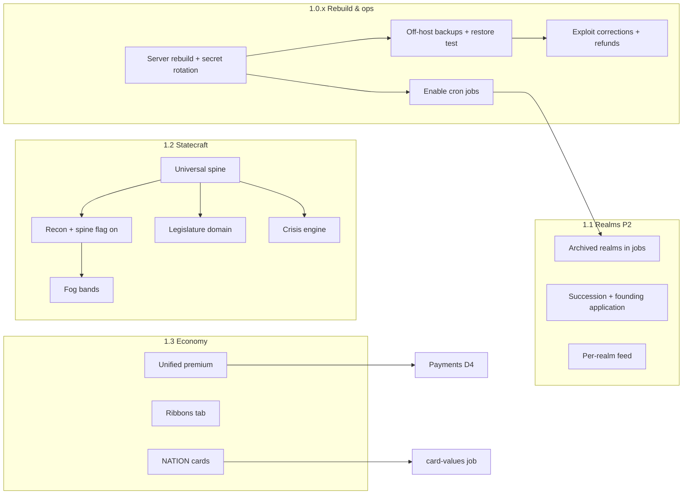

# IxStates Feature Roadmap

**Updated:** 2026-10-27 · **Baseline:** `master` after PR #119 (1.0.0 "Lobster Crosby" Stable, public; internal 1.5.0)
**Backlog:** [backlog.md](backlog.md), the single list of open items with their evidence. It keeps the code audit's
IDs (`MC-`, `AT-`, `WK-`, `VT-`, `SL-`, `PL-`), cites the old doc-based backlog's sections as `PF§1`–`PF§7` and the
post-release ops items as `OPS-`. The source audits are in [docs/history/roadmap/](../history/roadmap/) ·
[System Status](../systems/SYSTEM_STATUS.md) (what is live)

This is the plan: what to do, in what order, and why. Items refer to the backlog, which keeps the evidence (file
paths, callers, sizes). Milestones are ordered by risk and dependency, not by calendar.

**Version numbering.** The public reveal reset every user-facing number to 1.0: `src/lib/buildVersion.ts` holds
`VERSIONS` (public, shown to users) and `INTERNAL_VERSIONS` (what the platform has actually reached, read by the docs
and the Developer panel). Milestones below use the **public** numbers, with the internal equivalent in brackets.
Version targets are proposals; bump both registries together.

**Size:** S under a day · M 1–3 days · L more than 3 days. **Priority:** P0 must happen before the next release ·
P1 this milestone · P2 when capacity allows.

## Contents

- [Principles](#principles)
- [Shipped](#shipped)
- [Milestones at a glance](#milestones-at-a-glance)
- [Next: server rebuild and ops (1.0.x)](#next-server-rebuild-and-ops-10x)
- [1.1 — Realms Phase 2: open worlds](#11--realms-phase-2-open-worlds)
- [1.2 — The living nation: statecraft depth](#12--the-living-nation-statecraft-depth)
- [1.3 — Economy, collectibles & premium](#13--economy-collectibles--premium)
- [Ongoing: social & knowledge](#ongoing-social--knowledge)
- [Ongoing: Labs](#ongoing-labs)
- [Continuous: code health](#continuous-code-health)
- [Decisions needed](#decisions-needed)
- [Dependency map](#dependency-map)

---

## Principles

1. **Integrity before features.** Anything that mints currency, destroys other players' property, lets one user act as
   another, or loses data comes first, however small. Since the 2026-10 compromise this includes the server itself.
2. **Nothing on screen may lie.** A control that does nothing, a number that's made up, or a setting that isn't enforced
   either gets wired up or gets hidden.
3. **Finish before starting.** Partly built loops come before new pillars.
4. **Restore with a caller.** A restored deletion lands with the UI that calls it, so the zero-caller census doesn't
   delete it again.
5. **Decide, then build or drop.** Dead schema and half-built systems wait on an owner decision
   ([Decisions needed](#decisions-needed)) rather than lingering.

## Shipped

Release 1.5.0 "Lobster Crosby" (internal) went to production on 2026-10-26/27 as **public 1.0.0 "Lobster Crosby"
Stable**, served at https://beta.ixwiki.com (no base path); maps.ixwiki.com is the app's `/maps` page and the
separate IxWorld build is retired. The detailed per-item evidence for M0–M2 is in
[ACTION_PLAN_2026-10-05.md](../history/roadmap/ACTION_PLAN_2026-10-05.md) and the git history of this file.

| Milestone (old key) | Shipped | What it delivered |
|---|---|---|
| **M0** Integrity | PRs #36–#43, 2026-10-05 | Vault exploits closed (server-side store purchases, NS import, junk, bonuses, auctions); ThinkTank authorization; forum-link proof; admin audit log persists; budget year on IxTime; `db:backup`/`db:restore` and a pre-deploy `pg_dump`; every mutation rate-limited behind an architecture test. Ops leftovers (password rotation, production restore test, exploit corrections) are in the [backlog](backlog.md#1-owner-and-ops-actions) |
| **M1** Release baseline | 2026-10-05 → 2026-10-27 | Blocking CI (lint, typecheck of tests/scripts/db, `audit:arch`, script imports); cron monitoring, leases, paging and idempotent policy upkeep; market WebSocket Redis bridge; tag-based rollback; the web process under PM2 (`ixstats-web` in `ecosystem.config.example.cjs`, reloaded by `deploy-production.sh`); rose-garden promoted through `development` to `master` (PRs #118, #119) |
| **M2** Everything on screen works | 2026-10-05 → 2026-10-27 | Politics loop (elections, seated parties, bills), meeting outcomes, policy repeal/expiry, defense force authoring and combat strength, diplomacy inbox, stat history, pack/ledger fixes, achievement cards, ThinkTank docs/chat/invites, the trust pass (no fabricated numbers), every setting wired or hidden, navigation fixes, 63 help articles, Vexel attach (saving renders a PNG, attach writes it) |
| **WikiOS v1** (D20) | Merged 2026-10-06 (#52); launched 2026-10-27 | One `/wiki/[...slug]` route, move/delete/protect, native uploads mirrored to MediaWiki, edit conflicts, watchlist, rights engine, mirror outbox, `/w/api.php`; live two-way sync with classic MediaWiki (23,518 pages) |
| **Realms Phase 2, first half** | 2026-10-05 → 2026-10-25 | Status guard, admin founder assignment, claim visibility, builder in any realm, nation switcher, visibility rules, NationStates-style realm pages, Manage tab (settings, officers, rules, links, inactivity release, Hand over), archived realms read-only, world generation (Atlas Release A), realm clocks |
| **Economy** | 2026-10-05 → 2026-10-06 | Background achievements, cosmetics visible to others, the Exchange (₷) MVP and phase 2 (D5) |
| **Social** | 2026-10-05 → 2026-10-06 | Activity producers, trending, follows, moderation queue, full privacy controls, email and Web Push (off until configured) |
| **Code health** | 2026-10-27 | D9: 49 unused Prisma models dropped; narrator (D10) and ScheduledChange (D11) removed |
| **1.0 beta feedback** | PRs #112–#117, 2026-10-27 | MyCountry saves, ThinkPages composer/messages/accounts, ThinkTanks, Vault/Wiki nav and Trending UI, polar ice caps, maps served from the main app |

## Milestones at a glance

| Milestone | Internal | Goal | Rough size | Exit criteria |
|---|---|---|---|---|
| **1.0.x** Rebuild & ops | 1.5.x | Clean server, rotated secrets, ops backlog cleared | ~5–10 days | Running on a rebuilt host; every secret rotated; backup restored off-host; cron jobs on |
| **1.1** Realms Phase 2 | 1.6 | Founders run their worlds without a site admin | ~10–15 days | A founder runs a realm end to end, including archiving it, and nothing leaks into Ixnay |
| **1.2** Statecraft depth | 1.7 | IN → SEE → OUT → RIPPLE closed for issues, politics, diplomacy, crises | ~35–50 days | Issue → recon → decision → consequence works in each domain and is on the spine |
| **1.3** Economy & premium | 1.8 | Ribbons, NATION cards, one premium definition | ~20–30 days | Ribbons tab and NATION cards live; one premium definition; payments decided |
| ongoing | — | Social & knowledge; Labs; code health | — | Per-section |

1.0.x comes first and blocks everything else. After it, 1.1–1.3 can run in parallel tracks when there is more than
one contributor.

---

## Next: server rebuild and ops (1.0.x)

**Goal:** the production server was found compromised (since 2026-09-26) and contained. Rebuild on a clean host and
clear the ops items the 1.5 deploy left open. Details and IDs: [backlog §1](backlog.md#1-owner-and-ops-actions).

| Order | Item | Refs | P |
|---|---|---|---|
| 1 | **Server rebuild on a clean host with full secret rotation** (Clerk, Discord bot, database, Redis, cron secret, webhooks, API keys, SSH keys) | OPS-1 | P0 |
| 2 | Rotate the `ixstats_readonly` password (in git history); covered by 1 if done there | OPS-2, PF§1 | P0 |
| 3 | Test a `db:backup` restore into a scratch database; copy backups off-host | OPS-3, OPS-4, PL-11 | P0 |
| 4 | Review `audit:vault-exploits`, then apply (9 corrections, incl. −5,000 IxC); then `refund-lore-tokens` | OPS-5 | P0 |
| 5 | Review `audit:forum-links` (4 links without proof) | OPS-6, WK-1 | P1 |
| 6 | Confirm Clerk allowed origins for beta.ixwiki.com | OPS-13 | P1 |
| 7 | Enable the remaining cron jobs one per cycle ([release guide A7](../operations/release-guide.md#a7-cron-jobs)) | OPS-10, VT-15 | P1 |
| 8 | WikiOS weekly proof: fix `wikios-proof-cron.ts`, which pins `BASE_PATH=/projects/ixstates` | OPS-11 | P1 |
| 9 | Data hand-fixes: `Country.ownedSince` for 8 nations; link Carthinova to Kir; re-run card compliance `--fetch` | OPS-7, OPS-8, OPS-9 | P2 |
| 10 | Redis in production; drop CSP `'unsafe-inline'` after a violation check (no override on beta.ixwiki.com) | PF§5, PL-2 | P1 |

**Exit:** production runs on the rebuilt host with no secret from the compromised one; a restore from an off-host
copy has been tested; the exploit corrections are applied.

---

## 1.1 — Realms Phase 2: open worlds

*(internal 1.6)* **Goal:** a realm's founder can run their world without a site admin. Spec:
[realms-framework-spec.md](../architecture/realms-framework-spec.md). Founder settings, officers, rules, inactivity
release and Hand over already shipped (see [Shipped](#shipped)).

| Order | Item | Refs | Size |
|---|---|---|---|
| 1 | Archived realms excluded from jobs and payouts; every job made realm-aware (they are read-only on the site already) | PF§4, code audit §9 | M |
| 2 | Automatic succession when a founder goes inactive (`lastSeenAt`); founder removal of a nation beyond the inactivity release | PF§4 | M |
| 3 | Public founding application (decisions 6–7) | PF§4 | M |
| 4 | Per-realm ThinkPages feed plus a global-feed setting. **Partial:** a realm filter on the feed and realm boards; the dashboard feed and trending are not realm-scoped | PF§4 | M |
| 5 | WikiOS portal to every realm's lore; realm-tagged forum | PF§4 | M |

**Exit:** a test founder creates a realm (by application), approves claims, moderates, archives it, and nothing leaks
into Ixnay.

---

## 1.2 — The living nation: statecraft depth

*(internal 1.7)* **Goal:** close the Statecraft loop (IN → SEE → OUT → RIPPLE) for issues, politics, diplomacy and
crises. Sources: [design PRDs](../systems/mycountry-design-philosophy-and-prds.md),
[game loops](../systems/statecraft/statecraft-game-loops.md).

**Foundations** (in order)
1. **Universal event spine:** diplomacy, defense, elections and meetings write to it (PRD Rule 6); meeting decisions
   reach it and can become policies.
2. **Recon returns minutes and cables; `STATECRAFT_SPINE` on by default.**
3. **Information fog bands** at governance-competence thresholds (uses the stat history).
4. **Intelligence dashboard:** `/mycountry/intelligence` gets its own surface (threshold alerts already live on the
   overview, MC-17).

**Living world**
- **Crisis engine:** a producer (nothing writes `CrisisEvent` rows yet), lifecycle, response postures, admin UI.
- **NPC AI:** trait drift applied; responses to embassies, alliances and treaties; event-fatigue dampening.
- **Diplomatic Response AI;** relative-development asymmetry in trade maths.

**Depth** (roughly in dependency order)
- **Legislature domain:** party red lines; bills as intent nodes; mandate as a gate and multiplier.
- **Foreign Affairs domain:** `ForeignMission`, treaties as programs, summits as meetings, playable embassy missions.
- **Deliberation meeting loop** with 7 categories and participant profiles.
- **Intent DAG:** Vision, Strategic and Operational layers; government-generated Plans A/B/C.
- **Morning briefing and "since last visit";** the Decide / Review / Monitor / Celebrate state engine.
- **Reactive/proactive issue inbox;** a public governance ledger on the country profile.
- **Frameworks 1–4:** Milestone, Coalition, Geography, Crisis.
- **Live ERI, embassy synergy and GDP projection;** PII.
- **Directives that change transport network speeds.**

**Exit:** a player can go from issue to recon to decision to consequence in each domain, and every step is recorded on
the spine.

---

## 1.3 — Economy, collectibles & premium

*(internal 1.8)*

| Item | Refs | Size | Depends on |
|---|---|---|---|
| Unify the three premium definitions → real yield multiplier (`isPremium` is hard-coded `false` in `vault-ledger.ts`) → enforce tier limits | PF§3 | M | — |
| Payments/checkout (or keep premium admin-granted) | PF§4 | L | D4 |
| Ribbons tab and community ribbons (ribbons from real unlocks and the passport shelf are live) | PF§4, VT-8 | L | — |
| NATION card minting per country (no NATION card has a `countryId` yet, so the 2% royalty pays nothing); then `card-values` does real work | PF§3 | M | — |
| Remaining lore-first cleanup: unique slug, `@@unique([wikiArticleTitle, wikiSource])`, rarity distribution (the `CardRarity` enum shipped with the cards refresh) | PF§4 | M | — |
| Themed and realm packs; seasons (cards refresh Phases 4 and 5) | PF§4 | M | — |
| Exchange (₷) leftovers: other decision types, faucet tenders, a nation ₷ treasury, an order book ([spec](../specs/2026-10-06-exchange-economy-design.md#still-not-built), [system doc](../systems/exchange.md)) | VT-16 | M | — |

---

## Ongoing: social & knowledge

- **ThinkShare encryption:** build it or drop the fields (D7).
- **WikiOS restorations (each with its UI):** Margin reactions (`toggleCommentReaction`), the Stash and Inspect tabs;
  Stash notes and ordering.
- **Stash share links** with a visibility field.
- **Guardian:** mass-blanking and homoglyph abuse filter.
- **WikiOS Stage 3 MediaWiki isolation** and Workstream C packaging.
- **Notification delivery:** turn on email and Web Push when configured (ops).

---

## Ongoing: Labs

| Lab | Next items | Refs |
|---|---|---|
| MyLeague / MyClub | Boxing bout engine; Golden Box stage config and double elimination; patron-saint MyClub UI; promotion/relegation bulletin; broadcast mode, athlete cards, scouting/academy | PF§3–4 |
| Onoma | Phases 4, 5, 8, 9 finished → phases 6, 10 (LLM) → platform integration (toponyms, demonyms, dynasties) | [onoma-roadmap.md](../systems/onoma-roadmap.md) |
| Vexel | External ornaments, Commons charge seed, attribution, autosave, `[id]/preview`, P1 templates and conflicts | [Vexel PRD](../specs/2026-07-15-vexel-prd.md) |
| Strata, Dynas | Not started; scope first | — |

---

## Continuous: code health

Run throughout, preferably in PRs that already touch the area.

- **Dead schema:** the D9 drop is applied (49 models); left are the read-never-written and seed-only models
  (MC-19, `SharedVertex` AT-15, the intelligence models) ([backlog §5](backlog.md#5-dead-schema)).
- **Tests:** a router-level test for every top-level router (78 in `root.ts` now; all 69 had one on 2026-10-05) and
  the sub-router files no test imports, largest first.
- **Size ratchet:** `audit:arch` is blocking; keep shrinking the baselined files.
- **Refactors:** a service layer over direct `ctx.db`; one shared executive bandwidth module (MC-21).
- **Other:** logging framework decision; design-token cleanup from the Facet audits.
- **Dependencies:** Prisma 7 migration (dependabot #25), after the rebuild.

---

## Decisions needed

Open owner calls. Closed: D2 (a), D3 (b), D5 (a), D6 (moot), D8 (moot), D9 (applied 2026-10-27), D10 (retired),
D11 (deleted), D12 (XenForo only), D13 (branch model, [contributing.md](../processes/contributing.md#branches)),
D20 (WikiOS v1, launched).

| # | Decision | Options | Recommendation | Blocks |
|---|---|---|---|---|
| D1 | How politics gets candidates | (a) shipped in #49; (b) also seat parties by vote share | Close unless (b) is wanted for appointed chambers | 1.2 legislature |
| D4 | Premium & payments | (a) build checkout; (b) keep admin-granted premium, drop the pricing copy | (b) until the core loops are solid | 1.3 |
| D7 | ThinkShare encryption | Build real end-to-end encryption, or drop the schema fields and the flag | Drop | Schema drop |
| D14 | Vercel | Keep the `vercel.json` disable, or disconnect the integration | Disconnect | — |
| D15 | Gemini workflows | Add `GEMINI_API_KEY`, or delete the four `gemini-*.yml` workflows | Delete (Codex review already runs) | PL-14 |
| D21 | WikiOS site-editing rights | Remove the unused `editinterface` / `editsite*` grants from `src/lib/wiki-os/rights.ts` (nothing reads them), or keep them to match MediaWiki's group table | Remove (least privilege) | OPS-12 |
| D22 | Policy upkeep period | Confirm the annual (IxTime budget year) upkeep period for `policy-maintenance` (PL-8) | Confirm | — |

---

## Dependency map

