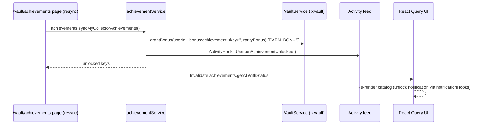

# 💎 Achievements & Progression Showcase

**Parent App Suite:** Vault (`IXVAULT_VERSION = 3`, dev codename `IxVault`)  
**Subsystem:** Achievements, Lorewards & Leaderboards (`ACHIEVEMENTS_VERSION = 3`)  
**Primary Action:** `PROGRESS` | **Domain Accent:** Raspberry (the Vault tint, `APP_TINTS.vault`)  
**Routes:** `/vault/achievements` (`/achievements` redirects there, query kept), `/leaderboards` | **Status:** Release Candidate (platform 1.5.0) — ribbons are derived from unlocks, see [Ribbons](#ribbons)  

Achievements live inside the Vault ([myvault.md](./myvault.md)). The registry holds **161 definitions** (`src/lib/achievements/sets/`): **114 active** and **47 Legacy**. The active ones are Executive 16, Politics 8, Diplomacy 10, Defense 2, Nation 12 (the nation categories, 48 in all) and Social 20, Wiki 7, Cards 15, Lorewards 8, General 16 (the platform categories, 66 in all). 62 of the active ones are account-level and unlock without a country; the other 52 need one. Unlocks grant IxCredits by rarity, an optional reward card (the Special card that names the achievement), packs and titles (per `rewardsJson`), and a showcase shelf entry. Wiki authoring is recognised by **Wiki Awards** (Lorewards), whose trophies are the Lorewards tab of the same page and whose achievements are the Lorewards category.

---

## Content

All durations are real time (`createdAt`, `respondedAt`, `joinedAt`, `ownedSince` and the like), never IxTime, so a realm with another clock is on equal footing; counts whose underlying rate follows a realm's clock (issues, directives, elections, budget years) also carry a real-time floor, emitted by the loaders as 0/1 flags.

- **Nation, early milestones (Common):** claim a nation, commit a directive, answer a national issue, set the budget, design your government, hold an election, pass a law, open an embassy, join an alliance, attach a Vexel coat of arms, found a military branch.
- **Executive (16):** issue-answering depth across weeks and domains (Steady hand, Head of state, Every corner, Crisis manager, Nothing left unanswered, Never off duty), directives (Full portfolio, Steady cadence, Long campaign, Discipline), power brokers (Grand coalition, All five estates) and Fiscal steward.
- **Politics (8):** Lawgiver, Council of state, Seasoned cabinet, Full term, Peaceful transitions, plus the early milestones.
- **Diplomacy (10) and Defense (2):** Lasting embassies, Good neighbour, Winning hearts, Cultural envoy, Consensus builder, Old friends, Alliance architect, Pacifist, and Peacekeeper (Defense).
- **Nation (12):** Stewardship I, II, III (`Country.ownedSince` 6 months, 18 months, 3 years), National identity, Heraldic house, Cartographer, Chronicler, the early milestones, and the kept flavour ones (`meme-stonks`, `meme-1337`, `meme-bankruptcy`).
- **Wiki (7), Social (20), Cards (15), Lorewards (8) and General (16):** edits and articles, forum and ThinkTanks activity (including a 7-day posting streak), packs, trades, sales, a first Legendary, deck value, daily-claim streaks, Loreward wins and streaks, tenure tiers, Renaissance (a wiki edit, a post or reply and card activity in the same week), first Onoma creation, first published Vexel design and first approved map edit. `vid-end-of-days` (Vidmaster Challenge: End of Days, General) needs every active Executive, Politics and Diplomacy achievement.
- **Real-time floors on gameable keys:** Council of state (25 decided meetings across 10 or more weeks), Cultural envoy (20 missions of 3 or more real days across 3 or more months), Chronicler (25 story pins across 6 or more months plus 5 in-world years), Consensus builder (proposals in alliances of 3 or more active members with another member's vote), the first Legendary card (from packs or trades, not NationStates import), Full portfolio (completions across 4 or more weeks) and Fiscal steward (every budget year of the last 18 months has an allocation and `ownedSince` is 18 or more months ago).
- **Not built, by decision:** set-completion achievements (no live completion data) and the "two closest to unlocking" on the Wallet. See the spec's Implementation notes.

### Legacy

Retired definitions carry `retired: true`; the sync writes `Achievement.isActive = false` for them once and skips them afterwards. They never evaluate, but existing unlocks, points and credits stay: they show greyed with a "Legacy" mark in All and Showcase, count toward the "unlock N achievements" tiers, and are left out of "N of total" (active only). The 47 are: GDP percentile, GDP per capita and population tiers, `econ-growth-rocket`, `econ-boom-cycle`, `econ-full-employment`, `econ-price-stability`, `econ-tax-efficiency`, `econ-tier-advancement`, the military spend and personnel tiers, `mil-armed-forces`, `mil-full-spectrum`, the embassy-count tiers, the treaty, trade and alliance-count ones, the atomic-component tiers and the six government-type badges. At boot `syncAchievements` (`src/instrumentation-node.ts`) retires them and creates the new definitions; `getAllWithStatus` also re-syncs when the table is behind the registry.

---

## Architecture & Versioning

In accordance with [reference/revision.md](../reference/revision.md), the system operates on **Achievements v3** (v2 added the automatic collector resync on page load; v3 is the Vault hub rebuild above). Ribbons are derived from real unlocks (see [Ribbons](#ribbons)); the separate OOC community ribbons in [the ribbons design spec](../specs/2026-08-10-achievements-ribbons-design.md) are not built.

### Frontend Modules
- `src/app/vault/achievements/page.tsx` – Standing card (unlocked of the active total, points, rank) above four tabs: **All**, **Lorewards** (the Vault wrapper of the shared `LorewardsView`), **Showcase** and **Leaderboard** (achievement points only, `api.achievements.getPlayerLeaderboard`). `?tab=` picks a tab and `?a=<key>` opens that achievement in All. `src/app/achievements/page.tsx` is now a redirect.
- `src/app/leaderboards/page.tsx` – Standalone nation leaderboards (GDP, population, density, growth: `CountryLeaderboards`), outside the Vault
- `src/components/achievements/tabs/` – `AllAchievementsTab` (category/rarity filters, search, grid/list toggle, secret reveal, Legacy last), `ShowcaseTab`, `LeaderboardTab`, `CountryLeaderboards`
- `src/components/achievements/constants.ts` – `ACHIEVEMENT_ICON_MAP`: every definition names an iconoir icon key (`src/lib/achievements/icons.ts`), stored in `Achievement.iconUrl` and rendered through that one map
- `src/components/achievements/FloatingRibbonRack.tsx` – `RibbonBar`, `FloatingRibbonRack` and `CountryOwnerRibbonRack`: ribbons drawn from the owner's real unlocks (see [Ribbons](#ribbons))

### Backend Routers
All achievement operations route through the modularized tRPC API:
- `src/server/api/routers/achievements/` (`index.ts`, `country.ts`, `progress.ts`, `management.ts`) – `getAllWithStatus`, `getMySummary` (`{ unlocked, activeTotal, points, rank }`), `getPlayerLeaderboard` (ties share a rank), `getRecentByCountry`, `getAllByCountry`, `getLeaderboard`, `getCountryLeaderboard`, and the `syncMyCollectorAchievements` / `unlock` mutations
- `src/lib/achievements/` (`definitions.ts`, `service.ts`, `sync.ts`, `unlock.ts`) – Condition evaluation (`checkAndUnlock`), reward payout (the reward card is the Special card whose `rewardAchievementKey` names the achievement, made in the cards admin Designer), the registry sync. The definitions are in `sets/` (`index.ts` exports `ALL_DEFINITIONS`; one file per set: `base`, `executive`, `politics`, `diplomacy`, `nation`, `platform`, `legacy`, `end-of-days`, plus `definitions-social.ts`)
- `src/lib/achievements/metrics/` – Metric loaders (`registry.ts` lists them; `executive`, `politics`, `diplomacy`, `nation`, `platform`). A loader is account-scope or country-scope, computes named numbers in at most 3 indexed queries with no unbounded row pulls, and a rule reads them from `data.metrics`; `time-buckets.ts` holds the real-time week/month bucketing
- `src/lib/achievements/scope.ts` – Which achievements are account-level (evaluate without a country) and which need one (derived from the loader scope of the metric a rule reads)
- `src/lib/achievements/queue.ts` – Background evaluation queue (`queueAchievementCheck`), drained by the worker in `service.ts`
- `src/lib/achievements/evaluate-cron.ts` – The `achievements-evaluate` cron job
- `src/server/api/routers/lorewards/` – Wiki editing medals, contribution tiers, and author awards
- Unlock side effects use `ActivityHooks.User.onAchievementUnlocked` (`src/lib/activity/hooks.ts`) and `notificationHooks.onAchievementUnlock` (`src/lib/notifications/hooks.ts`)

---

## Data Models

The system is backed by Prisma models in `prisma/schema/core.prisma` and `prisma/schema/wiki.prisma`:
- `Achievement`: Master definition keyed by `key`, with `category` and `rarity` (strings), `points`, `iconUrl`, `triggerType`, `conditionJson`, and `rewardsJson` (packs, titles). Credit rewards come from rarity-based bonus config, not a column.
- `UserAchievement`: User-level unlock (denormalized title/category/rarity, `metadata`, `unlockedAt`), unique per `userId` + `achievementId`
- `LorewardEntry`, `LorewardUserStats`, `LorewardCrossValidation`: Wiki contribution awards and scoring

Categories are plain strings: `Executive`, `Politics`, `Diplomacy`, `Defense`, `Nation`, `Social`, `Wiki`, `Cards`, `Lorewards`, `General`; there are no separate category or per-country progress tables — progress is evaluated from live account data and, when the user has one, live country data.

---

## Unlock & Reward Lifecycle

1. **Progress Evaluation**: `achievementService.checkAndUnlock(clerkUserId, countryId | null)` evaluates the active definitions. Unlocks are keyed by the Clerk user id (`UserAchievement.userId`).
   - **Account-level achievements** (62 of the 114 active, resolved by `scope.ts`) read only data that follows the person: tenure, the number of achievements held, own ThinkPages and forum activity, the card collection, wiki edits (the account's own revisions: those carrying its `authorId`, plus classic-wiki rows with no `authorId` whose author is exactly its verified link's name) and Lorewards (through a verified IxWiki link), and Heraldic house and Cartographer. They evaluate and unlock for users **without a country**. An admin-authored achievement without a built-in definition is account-level when its `conditionJson` rule reads an account-level metric.
   - **Country achievements** (the other 52: the Executive, Politics, Diplomacy and Defense sets, most of Nation, a country's followers, `gen-first-country`) are evaluated only against a country, and never pass without one. The country is the user's **active** country.
   - Unlocks that raise the achievement count are re-evaluated in the same run (up to 3 passes), so the meta achievements they qualify for unlock immediately.
2. **When evaluation runs**:
   - **Page visit**: on `/vault/achievements`, the client calls `achievements.syncMyCollectorAchievements` for any signed-in user, with or without a country.
   - **Event hooks**: one-line, non-blocking `queueAchievementCheck(userId)` calls at account creation, country creation (builder) and nation claims, pack opening, NationStates deck import, ThinkPages post creation and national-issue responses. The event bus (`country:updated`, `diplomacy:updated`, … fed by `ActivityHooks`) feeds the same queue. The queue lives in Redis (`achievements:queue`) when `REDIS_ENABLED`, otherwise in process (capped at 10,000 entries); the worker in `service.ts` drains one item a second and evaluates the user against their active country. Credit earns are not hooked, because no achievement reads credits.
   - **Cron**: `achievements-evaluate` (hourly at :41, off unless listed in `CRON_ENABLED_JOBS`) evaluates up to 500 users seen in the last 90 minutes (`User.lastSeenAt`), with or without a country. It is the backstop for anything the in-process queue loses on restart.
3. **Unlock & Payout**: A `UserAchievement` row is inserted (unique per user + achievement, so a concurrent run pays nothing) and IxCredits are granted once per achievement via `grantBonus()` with `oneTime` (idempotency key `bonus:achievement:<key>:<User.id>`; `EARN_BONUS`, uncapped: Common 100 → Legendary 2,500 IxC); any `rewardsJson` cards, packs and titles are awarded too (titles are stored in `UserAchievement.metadata` and are not rendered anywhere). `achievements.unlock` does the same for a named achievement key without evaluating criteria.
4. **Social Broadcast**: A notification and public activity post are generated for the global feed.
5. **Leaderboards**: `getPlayerLeaderboard` (the Vault tab) and `getLeaderboard` / `getCountryLeaderboard` (the nation boards at `/leaderboards`) aggregate unlocks on demand per query (no stored aggregation tables).

---

## Ribbons

A ribbon is an unlocked achievement worn as a service ribbon. There is no ribbon table: every `UserAchievement` row (keyed by Clerk id) is one ribbon.

- **Style:** the stripe comes from the achievement's category (Economic emerald, Military red, Diplomatic cyan, Government indigo, Social blue, General amber); `RIBBON_STRIPES` still lists only the old category names, so the new categories (Executive, Politics, Diplomacy, Defense, Nation, Wiki, Cards, Lorewards) draw the General amber stripe until it is extended; the star device from its rarity (bronze Common → white Legendary). Mappings: `ribbonStripe` / `ribbonDevice` in `FloatingRibbonRack.tsx`.
- **Order:** pinned ribbons first (in pin order), then rarest, then newest (`toRibbons`, `src/server/modules/identity/identity.showcase.ts`).
- **Signature ribbons:** the owner pins up to 3 on the passport's back face (`PassportPreference.pinnedRibbonKeys`); pins are kept only for achievements the owner has unlocked. Without pins, the rarest three lead.
- **Queries:** `ixnayid.getRibbons({ handle })` (every ribbon of a passport holder) and `ixnayid.getCountryRibbons({ countrySlug })` (the country owner's top 3 plus the total). Both return nothing when the owner hides achievements on their passport.
- **Where they show:** the passport showcase (signature shelf and the full ribbon rack) and the `/countries/[slug]` header, which renders nothing for a country with no active owner or an owner with no ribbons.

See [IxnayID Passport](./ixnayid-passport.md).

---

## Integration Points

- **IxVault**: Unlocking achievements directly awards IxCredits (`EARN_BONUS`) and, where configured, commemorative cards and packs (`UserPack.acquiredMethod = "ACHIEVEMENT"`). The Wallet's Achievements holding and the sidebar card read `getMySummary`; unlock notifications and Home-feed unlock items link to `/vault/achievements?a=<key>`.
- **Country profiles**: `CountryOwnerRibbonRack` shows the owning user's top 3 ribbons on `/countries/[slug]` headers, or nothing.
- **IxnayID Passport**: the passport showcase lists unlocked achievements, the ribbon rack and the signature shelf ([IxnayID Passport](./ixnayid-passport.md)).
- **WikiOS / Wiki Awards**: see [Lorewards](#lorewards) below.

---

## Lorewards

Lorewards are the daily, weekly and monthly wiki-writing contests (`src/lib/lorewards/`, `api.lorewards.*`). Entries come from the Discord bot's state file and the IxWiki OOL pages (`sync.ts`); today's race is scored live from WikiOS revisions.

- **One view, two homes:** `src/components/lorewards/LorewardsView.tsx` reads the `lorewards` router and takes `focus`. WikiOS `/util/lorewards` (a real page now, `focus="contest"`, wiki tint) leads with today's race (`lorewards.getTodayRace`: top 10 of the current UTC day, cached 10 minutes), the standings and recent winners; the Vault's Lorewards tab (`focus="you"`) leads with the player's trophies (`lorewards.getMyTrophies`: wins, runner-up places, streak, what Loreward payouts paid, today's rank, trophy cards). Each links to the other. The component imports nothing Vault-only because it ships in the standalone WikiOS bundle. `/wiki/lorewards` redirects to `/util/lorewards`.
- **Passport:** `PassportLorewardsModal` renders `LorewardsView` with `focus="you"` for the passport holder's wiki name (`lorewards.getTrophies({ username })`, public; the trophy cards list is left out when the holder hides their Vault cards).
- **Article badge:** the "Loreward winner" badge in a WikiOS article header opens `/util/lorewards?user=<winner>` (and `&card=<id>` for the trophy card once minted): the contest view with that winner's trophies above the race.
- **Payouts and trophy cards:** tiered credits by contest and place, and a one-of-one trophy card per place; see [ixcredits.md](./ixcredits.md#4-metagame-bonuses-earn_bonus--uncapped) and [cards.md](./cards.md#loreward-trophy-cards).
- **Achievements:** the eight Lorewards-category achievements: first Loreward, 5, 25 and 100 daily wins, first weekly win, first monthly win, a 7-day daily win streak, first runner-up.

---

## Known Gaps

- The OOC community ribbons from the [2026-08-10 spec](../specs/2026-08-10-achievements-ribbons-design.md) (WikiOS archivist, forum pioneer and so on) and a ribbons tab are not built; `FORUM_RIBBONS` in `constants.ts` is now unused. Ribbons today are the achievement-derived ones above.
- Background evaluation from the in-process queue runs only in the process that loads the achievements router (the web server); without Redis, a restart drops queued checks until the `achievements-evaluate` cron (when enabled) or a page visit picks the user up.
- The activity-feed post for an unlock is written only when the user has an active country (the feed is country-scoped); the notification is sent either way.
- `achievements.unlock` (grant a specific achievement to any `userId`) is admin-only; the app itself has no caller.

---

## Related Documentation

- [API Reference](../reference/api-complete.md)
- [IxCredits Economy Guide](./ixcredits.md)
- [WikiOS System Guide](./wikios/WIKIOS.md)
- Help: Achievements, in-app at `/help/gameplay/achievements` (source: [`src/content/help/gameplay/achievements.md`](../../src/content/help/gameplay/achievements.md))
