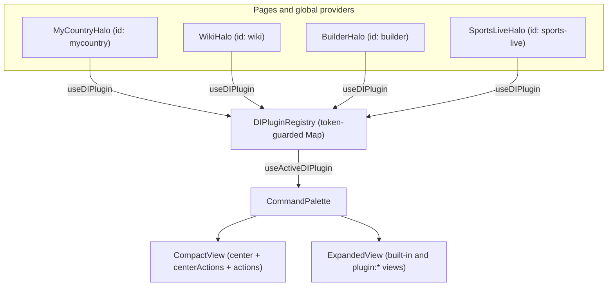

# Halo: Facet UI contextual overlay and command palette

Halo is the contextual floating island and command palette for IxStates, providing quick search, unified notifications and messages, quick settings, and domain-specific plugin overlays.

## What Halo is

`ShellHalo` mounts Halo top-centre above the content column (`left: var(--shell-sidebar-width)`, `right: var(--shell-inspector-width)`), leaving primary navigation to `AppSidebar` and `TabBar`. In its collapsed pill it shows the IxTime clock, greeting or active plugin breadcrumb, navigation loading feedback, and triggers for Search, Notifications, Settings, and the user's country view. Expanding Halo morphs the chrome capsule into a non-modal dialog (`role="dialog"`, `aria-modal="false"`) for built-in views or route-registered plugin views. Halo hides itself on `/maps`, where `MapDynamicIsland` owns the floating map controls.

## Versions

- **Last updated:** 2026-11-14
- **Version registry:** [`src/lib/buildVersion.ts`](../../src/lib/buildVersion.ts)
  - **Halo:** `INTERNAL_VERSIONS.systems.halo = 6`, `VERSIONS.systems.halo = 1` (`HALO_VERSION = "1"`)
  - **Facet design system:** `INTERNAL_VERSIONS.design.facet = 6`, `VERSIONS.design.facet = 3` (`FACET_VERSION = "3"`)
  - **Platform:** internal `1.5.5 "Lobster Crosby"` (Release Candidate), public `1.0.6 "Lobster Crosby"` (Stable)
- **System status:** Live; see [SYSTEM_STATUS.md](./SYSTEM_STATUS.md)

## Files

Generated from `find src/components/halo src/lib/halo -type f | sort`:

- `src/components/halo/HaloPrimitives.tsx`: `HaloProvider`, `useHaloSize`, `Halo`, and `HaloContainer` layout morph primitives
- `src/components/halo/HaloTourContext.tsx`: Guided tour step state and custom event dispatch for Halo walkthroughs
- `src/components/halo/HaloTourTooltip.tsx`: Anchored onboarding tooltip callout with skip and next controls
- `src/components/halo/country-actions.ts`: Shared `COUNTRY_ACTIONS` table and `countryProfilePath` helper used across country views
- `src/components/halo/halo-registry.ts`: Command types, `CORE_FEATURES`, and `commandsFor` wrapper over `commandsFromApps`
- `src/components/halo/hooks.ts`: `useDynamicIslandState` hook wiring `haloReducer`, debounced queries, `searchCatalog`, and global shortcuts
- `src/components/halo/index.tsx`: `CommandPalette` root component, dialog focus management, outside-pointer dismiss, and size sync
- `src/components/halo/plugin-context.tsx`: `DIPluginRegistry` external store (`useSyncExternalStore`), `useDIPlugin`, and `useActiveDIPlugin`
- `src/components/halo/plugins/builder/BuilderHalo.tsx`: Plugin for `/builder` and `/mycountry/editor` exposing section jumps
- `src/components/halo/plugins/builder/index.ts`: Barrel export for `BuilderHalo` and builder plugin types
- `src/components/halo/plugins/builder/types.ts`: `BuilderHaloSection` and `BuilderHaloContext` interfaces
- `src/components/halo/plugins/builder/views/JumpToSectionView.tsx`: Expanded list of founding steps or editor anchors
- `src/components/halo/plugins/builder/views/index.ts`: Barrel export for `JumpToSectionView`
- `src/components/halo/plugins/mycountry/MyCountryHalo.tsx`: Plugin for `/mycountry` routes registering quick country actions
- `src/components/halo/plugins/mycountry/index.ts`: Barrel export for `MyCountryHalo` and MyCountry Halo views
- `src/components/halo/plugins/mycountry/views/MyCountryActionsView.tsx`: Quick-action grid for Diplomacy, Executive, and Defense
- `src/components/halo/plugins/mycountry/views/MyCountryView.tsx`: Account and nation summary card, KPI toggles, and country actions grid
- `src/components/halo/plugins/mycountry/views/index.ts`: Barrel export for `MyCountryView` and `MyCountryActionsView`
- `src/components/halo/plugins/sports/SportsLiveHalo.tsx`: Live match scoreboard pill and expanded broadcast view
- `src/components/halo/plugins/sports/index.ts`: Barrel export for `SportsLiveHalo`
- `src/components/halo/plugins/wiki/WikiHalo.tsx`: Wiki article breadcrumb, section jump popover, narrator controls, and lazy view registration
- `src/components/halo/plugins/wiki/accent.ts`: Contrast-safe Wiki accent colour resolver (`wikiAccent`, `accentMix`)
- `src/components/halo/plugins/wiki/components/PlayPauseMorph.tsx`: SVG play/pause icon morph for narrator transport controls
- `src/components/halo/plugins/wiki/components/WikiNarratorPlayer.tsx`: Audio narrator transport, chapter scrubber, and voice/speed/volume wells
- `src/components/halo/plugins/wiki/components/WikiSearchDropdown.tsx`: Inline debounced full-text Wiki article search input and results list
- `src/components/halo/plugins/wiki/components/WikiWorkspaceTab.tsx`: Article actions, collapsible outline, local drafts, and paused reading sessions
- `src/components/halo/plugins/wiki/components/index.ts`: Barrel export for Wiki Halo subcomponents
- `src/components/halo/plugins/wiki/index.ts`: Barrel export for `WikiHalo` and Wiki plugin views
- `src/components/halo/plugins/wiki/types.ts`: Narrator engine/voice constants, `LocalDraft`, and `PausedSession` types
- `src/components/halo/plugins/wiki/views/WikiNarratorView.tsx`: Dedicated Now Playing narrator expanded view
- `src/components/halo/plugins/wiki/views/WikiProfileView.tsx`: Tabbed Wiki workspace/scratchpad, Lorewards profile stats, and country actions
- `src/components/halo/plugins/wiki/views/WikiView.tsx`: Primary expanded Wiki workspace and narrator switcher view
- `src/components/halo/plugins/wiki/views/index.ts`: Barrel export for Wiki expanded views
- `src/components/halo/presets.ts`: Capsule `SizePresets` union, `SIZE_PRESETS`, and `DynamicIslandSizePresets` geometry table
- `src/components/halo/types.ts`: `DIPlugin`, `DIViewProps`, `ViewMode`, `SearchFilter`, `SearchResult`, and view prop interfaces
- `src/components/halo/views/CompactView.tsx`: Collapsed pill with center button, `pluginCenterActions` slot, toast peek, and right action rail
- `src/components/halo/views/ExpandedView.tsx`: Lazy-loaded view router (`next/dynamic`) switching built-in and `plugin:*` views
- `src/components/halo/views/NavTray.tsx`: Secondary quick-navigation popover tray derived from `getVisibleApps` and `TAB_BAR_PRIORITY`
- `src/components/halo/views/NotificationsView.tsx`: Alert and direct-message inbox tray with unread counts, grouping, and swipe rows
- `src/components/halo/views/SearchView.tsx`: Accessible combobox/listbox command palette and search view
- `src/components/halo/views/SettingsView.tsx`: Quick settings panel using `FacetList`/`FacetRow` for appearance, sound, and Wiki reader preferences
- `src/components/halo/views/compact/HaloIconButton.tsx`: Compact pill icon button wrapping `Button` with tooltip and optional count dot
- `src/components/halo/views/compact/NarratorProgress.tsx`: Compact pill narrator progress ring
- `src/components/halo/views/index.ts`: Barrel export for `CompactView` and `ExpandedView`
- `src/components/halo/views/settings/SettingsControls.tsx`: `useLocalPref`, `ToggleSwitch`, and `SectionLabel` helpers for `SettingsView`
- `src/components/halo/views/shared/HaloViewParts.tsx`: Shared `HaloViewHeader`, `HaloCloseButton`, and `HaloEmpty` primitives
- `src/components/halo/views/tray/MessageTrayItem.tsx`: Swipeable conversation row in the Messages tab of `NotificationsView`
- `src/components/halo/views/tray/NotificationRow.tsx`: Swipeable alert row with expandable details in `NotificationsView`
- `src/components/halo/views/tray/types.ts`: Notification item types, relative-time formatter, and category icon/colour helpers
- `src/lib/halo/commands-from-apps.ts`: Derives Halo command entries from `APPS` + `getVisibleApps`, `NAV_COMMAND_META`, and `EXTRA_HALO_COMMANDS`
- `src/lib/halo/halo-state.ts`: Pure `haloReducer` state machine (`HaloState`, `HaloEvent`, `INITIAL_HALO_STATE`)
- `src/lib/halo/search.ts`: Pure search indexing and ranking helpers (`buildIndex`, `commandEntriesFor`, `searchCatalog`)

## Views and state

Halo open/close state is driven by `haloReducer` in [`src/lib/halo/halo-state.ts`](../../src/lib/halo/halo-state.ts) rather than separate boolean flags:

- **States (`HaloState`):**
  - `{ status: "compact" }`: collapsed pill (`mode === "compact"`).
  - `{ status: "expanded", view: ViewMode }`: open dialog rendering `"search"`, `"notifications"`, `"settings"`, `"mycountry"`, or `` `plugin:${string}` ``.
- **Events (`HaloEvent`):**
  - `{ type: "open", view }`: expands into `view` (or collapses if `view === "compact"`).
  - `{ type: "close" }`: returns to `{ status: "compact" }`.
  - `{ type: "toggle", view }`: closes if already expanded on `view`, otherwise opens `view`.
  - `{ type: "plugin-changed", firstView, pluginGone, availableViews }`: keeps built-in views untouched, collapses an open `plugin:*` view if the active plugin unmounts or drops that view key, and preserves an open `plugin:*` view while its key remains in `availableViews`.

Seven size presets remain in [`src/components/halo/presets.ts`](../../src/components/halo/presets.ts):

- **Compact (`width: "fit-content"`, `height: "auto"`):** `default`, `compactLong` (pill baseline), `compactTall` (active plugin pill), `wikiInline`.
- **Expanded (`width` from preset, `height: "auto"`):** `medium` (`371px`, settings and compact plugin sheets), `tall` (`371px`, `42px` radius, search, notifications, MyCountry, Wiki), `ultra` (`630px` desktop / `350px` capped mobile, expanded notifications or two-column Wiki reader settings).

When expanded, `CommandPalette` renders `role="dialog"` with `aria-modal="false"` and a mode-specific `aria-label`, moves focus into the dialog (the search input for `"search"`, or the first focusable control for other views), closes on outside `pointerdown` (ignoring portaled Radix popovers/menus), and restores focus to the trigger element on keyboard/button close.

## Plugins

Routes and providers register contextual overlays through `useDIPlugin(plugin)` in [`src/components/halo/plugin-context.tsx`](../../src/components/halo/plugin-context.tsx), backed by `useSyncExternalStore`.

```typescript
export interface DIViewProps<F = unknown, C = unknown> {
  onClose: () => void;
  onSwitchMode?: (mode: ViewMode) => void;
  filter?: F;
  context?: C;
}

interface DIAction {
  id: string;
  icon: React.ComponentType<{ className?: string }>;
  label: string;
  onClick: () => void;
  badge?: number;
}

interface DIBadge {
  color: string;
}

export interface DIPlugin<F = unknown, C = unknown> {
  id: string;
  priority?: number;
  center?: React.ReactNode;
  centerActions?: React.ReactNode;
  expandedViews?: Record<string, React.ComponentType<DIViewProps<any, any>>>;
  badge?: DIBadge;
  actions?: DIAction[];
  accentColor?: string;
  filter?: F;
  context?: C;
}
```

### Registry rules

1. **Priority and ties:** `useActiveDIPlugin()` selects the registered plugin with the highest `priority` (default `0`). Comparison is strictly `>`, so when two plugins share a priority, the earlier entry in the `Map` keeps precedence.
2. **Token-guarded unregister:** `register(plugin)` mints a unique `Symbol(plugin.id)` token, and `unregister(id, token)` deletes the entry only when the stored token matches. During overlapping layout transitions where a new page mounts a plugin with the same `id` before the previous page's cleanup runs, the stale cleanup cannot evict the newer registration.
3. **Interactive controls in the pill:** `center` sits inside the pill's primary `<button>`, so plugins must place any interactive pill controls (popovers, play/pause buttons) in `centerActions`, which renders as a sibling outside the primary `<button>`.



### Registered plugins

| Plugin           | `id`            | Priority                                   | Expanded views                                                                                                                             | Notes                                                                                                                            |
| ---------------- | --------------- | ------------------------------------------ | ------------------------------------------------------------------------------------------------------------------------------------------ | -------------------------------------------------------------------------------------------------------------------------------- |
| `MyCountryHalo`  | `"mycountry"`   | `5`                                        | `mycountry` (`MyCountryActionsView`)                                                                                                       | Mounted on `/mycountry` routes; built-in `"mycountry"` mode renders `MyCountryView` from the avatar/crown button                 |
| `WikiHalo`       | `"wiki"`        | `10` (`50` paused narrator, `100` playing) | `wiki` (`WikiView`), `profile` (`WikiProfileView` when no `articleTitle`), `narrator` (`WikiNarratorView` when narrator access is enabled) | Uses `centerActions` for the section jump `Popover` and narrator `PlayPauseMorph`; expanded views load lazily via `next/dynamic` |
| `BuilderHalo`    | `"builder"`     | `20`                                       | `sections` (`JumpToSectionView`)                                                                                                           | Mounted on `/builder` and `/mycountry/editor`; outranks `mycountry` and `wiki` on editor routes                                  |
| `SportsLiveHalo` | `"sports-live"` | `100`                                      | `sports-live` (`SportsLiveView`)                                                                                                           | Mounted globally; registers only while one of the signed-in user's clubs has an active live match broadcast                      |

## Command palette

Command entries derive from the sidebar navigation model (`APPS` and `getVisibleApps` in [`src/lib/navigation/app-sections.ts`](../../src/lib/navigation/app-sections.ts)) via [`src/lib/halo/commands-from-apps.ts`](../../src/lib/halo/commands-from-apps.ts) (`NAV_COMMAND_META` + `EXTRA_HALO_COMMANDS`), while `CORE_FEATURES` lives in [`src/components/halo/halo-registry.ts`](../../src/components/halo/halo-registry.ts). `FacetShell` passes `trayApps` (strict viewer visibility for `NavTray`) and `searchApps` (respecting admin tab toggles and role gates) down through `ShellHalo` into `CommandPalette`. Pure indexing and ranking live in [`src/lib/halo/search.ts`](../../src/lib/halo/search.ts):

- **Viewer commands first:** `commandEntriesFor({ isAdmin, signedIn, pathname, searchApps })` prepends viewer-specific entries (`Sign in` and `Sign up` when signed out, `Sign out` when signed in, plus `Country profile` when viewing `/countries/<slug>`) ahead of `commandsFromVisibleApps(searchApps)` (or `commandsFor(isAdmin)`) so they are not truncated under the 3-per-category `"all"` cap.
- **Per-filter limits and ordering:** `searchCatalog(query, filter, sources, { wikiFirst })` returns up to 3 matches per source when `filter === "all"` and up to 12 when a single filter is selected (capped at 12 total). Under `"all"`, results are ordered `[countries, commands, features, wiki]` by default, or `[wiki, countries, commands, features]` when `wikiFirst` is true (active Wiki plugin). Wiki queries run once the debounced query is at least 2 characters.
- **Initial filter on Wiki pages:** Opening Search checks `localStorage["wikios:dynamicSearchWiki"]` (default `true`); when enabled on a Wiki page, Search starts on the `"wiki"` filter, otherwise `"all"`.
- **Execution:** Navigating entries route client-side via `navigateWithBasePath(path, router)` (preserving React state and Halo's layout morph); `#search`, `#notifications`, and `#settings` switch Halo views; `actionId` entries (`toggle-theme`, `toggle-sound`, `toggle-compact`, `mark-all-read`, `reload-data`, `random-wiki`, `sign-out`, `random-country`) run only when activated via `Enter` or click.
- **Route verification:** [`src/tests/components/halo/halo-registry-routes.test.ts`](../../src/tests/components/halo/halo-registry-routes.test.ts) verifies that every derived palette and `NavTray` path resolves to a real `src/app/**/page.tsx` route without duplicates.

## Keyboard

Global shortcuts in `hooks.ts` listen only for modifier chords (plus `Escape` when Halo is open) and never call `preventDefault()` on unhandled keys, so page typing and `Tab` focus traversal are never blocked. Auto-repeated `keydown` events (`e.repeat`) on toggle chords and `Escape` are ignored.

| Key or chord               | Scope                                          | Behaviour                                                                             |
| -------------------------- | ---------------------------------------------- | ------------------------------------------------------------------------------------- |
| `Cmd+K` / `Ctrl+K`         | Global (outside inputs, or inside Halo search) | Opens Search, or closes Halo if Search is already open                                |
| `Cmd+,` / `Ctrl+,`         | Global (outside text inputs)                   | Toggles Halo quick settings (`"settings"`)                                            |
| `Escape`                   | Search input or open Halo view                 | Clears non-empty search query first; otherwise closes Halo and restores trigger focus |
| `ArrowDown` / `ArrowUp`    | Search input (`role="combobox"`)               | Cycles `aria-activedescendant` across result options and scrolls active row into view |
| `Enter`                    | Search input (when not IME-composing)          | Closes Halo and executes or navigates to the active search result                     |
| `ArrowLeft` / `ArrowRight` | Search filter `SegmentedControl`               | Moves between `All`, `Wiki`, `Countries`, `Commands`, and `Features` filters          |

## Motion

`HaloPrimitives.tsx` drives capsule expansion and collapse on the compositor via Motion layout projection (`layout` on the outer `facet-chrome` `motion.div`, `layout="position"` on the inner content wrapper), without `ResizeObserver` state writes or animated `width`/`height` keyframes. While `useNavigationLoading()` reports an in-flight route transition, the compact pill cross-fades a spinner into the Search button slot without shifting pill width.

All transitions import shared Facet motion tokens from [`src/lib/design/motion.ts`](../../src/lib/design/motion.ts) (`springSnappy` for the island morph and `HaloContainer`, `springSmooth` for `NavTray`, `tweenFast` for micro-disclosures, `tweenExit` for exits, and `REDUCED_MOTION_FADE` when `useFacetReducedMotion()` is active). Under Reduce Motion (`prefers-reduced-motion: reduce`), the layout morph uses `{ duration: 0 }` (`data-reduced-motion="true"`) and view/peek swaps cross-fade opacity only via `REDUCED_MOTION_FADE`. Motion, z-index, shadow, and colour-mix rules are enforced by [`src/tests/architecture/halo-motion.test.ts`](../../src/tests/architecture/halo-motion.test.ts).

## Related docs

- [MyCountry Design & Statecraft Guide](./mycountry.md)
- [WikiOS System Guide](./wikios/WIKIOS.md)
- [ThinkPages forum](./forum.md)
- [Cards & Vault System](./cards.md)
- [Facet Design System](../reference/facet-design-system.md)
