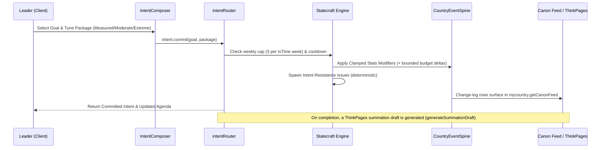

# 🏛️ MyCountry Suite — Executive Simulation & Governance

**Last updated:** 2026-10-05

**Parent App Suite:** MyCountry Suite (`INTERNAL_VERSIONS.systems.mycountry` = 6, public v1)  
**Engine:** Statecraft Simulation Engine (`MYCOUNTRY_ENGINE_VERSION = 4`)  
**Primary Action:** `GOVERN` | **Domain Accent:** Amber Gold (`#F59E0B` / `--color-amber-500`)  
**Route:** `/mycountry` | **Status:** see [SYSTEM_STATUS.md](SYSTEM_STATUS.md); the command surface is live, but Politics, Diplomacy, Economy and National Issues are 🟡 Partial (loops below)

The MyCountry Suite provides sovereign leaders with an executive command environment. Built around the single-page **Command Surface** architecture, it unifies decision-making, foreign relations, macroeconomic planning, and legislative governance into an action-first workflow.

> **Open to every player:** **Overview/Executive**, **Economy**, **Politics**, and **Diplomacy** (`src/lib/auth/ability.ts`).  
> _(**Defense** (which also serves `/mycountry/intelligence`) is premium-gated: locked behind `PremiumPreviewFrame`. The **Map Editor** is free for every owner. The command document's `DocumentRibbon` (`src/components/mycountry/shell/mycountry-tabs.ts`) lists Defense only for MyCountry Premium members and beta testers; the pages keep their premium preview for anyone who arrives by URL.)_

---

## Single Production Command Surface Architecture

MyCountry has fully unified around the single production **Command Surface** (`CommandSurface.tsx`), sharing the public Country Profile's document anatomy while preserving MyCountry's executive gold identity and private readings.

```
┌────────────────────────────────────────────────────────────────────────┐
│            COMMAND SURFACE (src/components/mycountry/shell/)           │
├───────────────────────────────────┬────────────────────────────────────┤
│ 1. Sticky Compact Chrome Bar      │ Zero-flow-height until the hero    │
│    headers/UnifiedGlassCommandBar │ scrolls off; fades in around Halo  │
├───────────────────────────────────┼────────────────────────────────────┤
│ 2. Command Document (face+ribbon) │ Live territory stage (Monogram     │
│    face/CommandDocument.tsx       │ fallback), frosted Lens identity,  │
│    face/CommandBand.tsx           │ RingGrid + bandwidth/slots/issues, │
│    mycountry-tabs.ts              │ DocumentRibbon + CommandActions    │
├───────────────────────────────────┼────────────────────────────────────┤
│ 3. Overview body                  │ FirstStepsCard, alerts, priority   │
│    ExecutiveHome.tsx              │ hero, Reminders/swipe Agenda,      │
│                                   │ recent activity                    │
├───────────────────────────────────┼────────────────────────────────────┤
│ 4. Domain Command Surfaces        │ Full-page modes for Diplomacy,     │
│    DomainSurface.tsx              │ Defense, Politics, and Economy     │
├───────────────────────────────────┼────────────────────────────────────┤
│ 5. Slide-Over Drill Sheets        │ Deep policy tuning, legislature    │
│    DrillSheets.tsx                │ config, and relations inspection   │
└───────────────────────────────────┴────────────────────────────────────┘
```

### Overview layout & design (Facet / Apple HIG)

The overview reads top to bottom as one hierarchy, on an 8pt spacing rhythm (24px between cards), following the Facet 4 rules ([facet-design-system.md](../reference/facet-design-system.md)):

1. **Command Document** (`face/CommandDocument.tsx`) — sits flush at the top of the viewport like `CountryDocument`: `CountryHeroCard` (`frameless`) hosting `CommandMedia.tsx` (live `CountryMapEmbed` with Edit territory and Open world maps Chrome controls, falling back to `MonogramBanner` + "Draw your territory" when there is no geometry), `CommandIdentity.tsx` (`FlagTile` and `<h1>` wrapped in `SharedElement` so switching to/from `/countries/[slug]` morphs them), a `Public profile` button, `CommandBand.tsx` (shared `RingGrid`, `facet-well` executive bandwidth meter + `BandwidthHelp`, weekly directive slots, internal stability, and inline open/urgent issue chips when > 0), and the attached `DocumentRibbon` (**Overview · Directives · Economy · Diplomacy · Politics · Defense**, with `issues-pending` and `diplomacy-inbox` count pills plus trailing `CommandActions` for `EditMorphButton` and context-aware **Declare Directive**).
2. **Sticky Compact Chrome Bar** (`headers/UnifiedGlassCommandBar.tsx`) — zero-flow-height while the document is on screen; once the face's `<h1>` scrolls out of view (`collapseOn`), it mounts a `facet-chrome` bar around Halo showing the country name, a `SectionMenu` dropdown, edit, and Declare Directive.
3. **Overview panel** (`ExecutiveHome.tsx`) — `FirstStepsCard` (when incomplete) and `IntelligenceAlertsCard` (`IntelligenceAlertsCard.tsx`, shown only while threshold alerts are open), `ExecutiveOpportunityHero.tsx` (dismissible priority card using `AnimatePresence mode="popLayout"`, `springSmooth`, `tweenExit`), and a 2:1 split of `ExecutiveAgenda.tsx` + `ExecutiveRecordFeed.tsx` (`content="feed"`, realm-clock timestamps, no nested scrollbars).

**Agenda (`ExecutiveAgenda.tsx`).** Derived from live state (`agenda.ts`: open national issues, active directives, upcoming elections, and pressing corporate/treasury signals), sorted most pressing first. Shows the top 5 rows with **Show all (N)** rather than an inner scroller. Completing an item via its trailing Reminders circle (`springSnappy` check fill) or touch swipe-left (`SwipeableRow` with rubber-band elasticity, flick velocity commit, and `springMomentum`) hides it per country in `localStorage` (`ixstats:agenda-done:<countryId>`) and raises an immediate `Undo` toast.

Rules the overview follows:

- **Real data only.** Figures come from live queries; missing figures render `–` or omit optional cards, never fabricated sample numbers.
- **Facet primitives, not a local kit.** Surfaces use `Card`, `CardTitle`, `Stat`, `Progress`, `Button`, `Badge`, `DropdownMenu`, `DocumentRibbon`, and `SwipeableRow`. Glass never nests; recessed readouts inside cards use `facet-well`.
- **Gold.** Inside `data-app="mycountry"` the plain `<Button>` is the flat gold primary; never hand-roll a `bg-yellow` class. `STATUS_FILL.accent` uses `bg-tint`. Domains are identified by their glyph and label (`domain-meta.ts`); there are no glows or per-domain hero washes.
- **At most one control tier inside a panel.** The `DocumentRibbon` on `CommandDocument` is the section tier; Directives history filters use a `DropdownMenu` (`HistoryFilterMenu`) rather than a nested `SegmentedControl`, and `DomainSurface.tsx` relies on the command bar's single Declare Directive button rather than repeating a domain header row.

### Key Component Architecture

All under `src/components/mycountry/shell/` unless noted.

- `CommandSurface.tsx` – Master viewport wrapper, sticky toolbar + `CommandDocument` + `<ViewTransition default="mycountry-section">` section host
- `face/` – `CommandDocument.tsx`, `CommandIdentity.tsx`, `CommandMedia.tsx`, `CommandBand.tsx`, `command-figures.ts`
- `mycountry-tabs.ts` – `MYCOUNTRY_TABS`, `visibleTabs`, `tabForSection` for the attached `DocumentRibbon`
- `ExecutiveHome.tsx` – Overview body: `FirstStepsCard`, `IntelligenceAlertsCard`, `ExecutiveOpportunityHero`, `ExecutiveAgenda`, and `ExecutiveRecordFeed`
- `ExecutiveAgenda.tsx` – Reminders-style + swipeable agenda list (`agenda.ts`: `deriveAgendaItems`, `formatAgendaTime`)
- `IntelligenceAlertsCard.tsx` – Intelligence alerts card: open threshold alerts from `intelligence.getMyAlerts`, most severe first, with mark read, mark all read and dismiss; `?focus=alerts` scrolls to it
- `ExecutiveOpportunityHero.tsx` – Spotlight hero prioritizing critical national signals
- `DomainSurface.tsx` – Specialized domain view for Diplomacy, Defense, Politics, Economy
- `DomainContextRail.tsx` – Contextual KPI trends and event activity logs
- `DrillSheets.tsx` – Slide-over sheets for deep parameter adjustment
- `shared/headers/IssueDetailBrief.tsx` – 4-branch issue resolution brief modal
- `ExecutiveConsole.tsx` – The Directives page (`/mycountry/executive`); renders `directives/DirectivesWorkspace.tsx` (see [Directives page](#directives-page-mycountryexecutive))
- `rails/` – Per-domain context rails (`EconomyRail`, `PoliticsRail`, `RelationsRail`, `DefenseRail`, `RailCard` / `RailBar` in `rails/shared.tsx`)
- `status-tone.ts` – `STATUS_TEXT` and `STATUS_FILL` (critical / warning / accent / neutral); `domain-meta.ts` – the four domains' titles, icons, routes and suggested goals (`DOMAIN_META`)
- `MyCountryRouter.tsx` / `mycountry-sections.ts` – Single-page section router and the route ↔ section map; rendered once by `src/app/mycountry/(command)/layout.tsx`, whose section pages return `null`; section navigation lives on `CommandDocument`'s `DocumentRibbon` while the app sidebar (`src/lib/navigation/app-sections.ts`) carries the MyCountry app row (`issues-pending` badge) plus `Public profile` and `Editor`

---

## Statecraft Engine & Directives Architecture

A foundational rule of the platform:

- **Frontend (UI)**: **Directives** is the universal user-facing brand across all UI components, buttons, and dialogs (`"Declare Directive"`, `"Tune Custom Directive"`, `"Executive Directives Agenda"`).
- **Backend (Engine)**: The **Statecraft Simulation Engine** (`src/lib/statecraft/*.ts`, `src/lib/intent/*.ts`, `src/server/api/routers/intent/`) powers intent parsing, power broker alignments, civil capacity throughput, and recon research.



### Directives page (`/mycountry/executive`)

`CommandSurface` renders `ExecutiveConsole` → `src/components/mycountry/directives/DirectivesWorkspace.tsx`. Weekly directive slots and executive bandwidth already live in `CommandBand` directly above, so the workspace opens immediately into:

1. **Views + actions bar** (`Tabs`, with arrow-key roving focus): **New directive**, **In force**, **History**, paired inline with any cooldown countdown (`DirectiveStatusLine`) and **Draft a custom policy** (`PolicyCreatorSheet`).
   - **New directive** — the composer (`shared/primitives/IntentComposer.tsx`, parts in `shared/primitives/composer/`) as four steps:
     1. _Goal_: search or type a goal, or browse the presets (`composer/directive-presets.ts`, 8 domains) with domain filter toggles (`Toggle`). "Suggest one" picks a preset for the nation's weakest signal (crime → Security, low readiness → Defense, low approval → Social). A custom goal is used as typed; foreign-policy goals are refused by `classifyGoal` and the error is shown with "Change goal".
     2. _Approach_: Measured / Moderate / Extreme, plus Broker deal when the aligned broker is unlocked (`intent.suggest`). Each shows its executive bandwidth cost, acceptance and whether it can raise resistance. The structural tier is not offered (it has no unlock check yet).
     3. _Projected impact_: the levers (budget notches, policy, statement), the stat effects in English with favourable/unfavourable colouring (`lib/intent/consequence-labels.ts`), the GDP level shift phased in over `GROWTH_EFFECT_YEARS` (`suggest` returns `gdpLevelShift` / `gdpEffectYears` per package), stakeholder acceptance, the aligned broker, and a resistance warning for moderate/extreme.
     4. _Review and declare_: goal, approach, executive bandwidth held, available executive bandwidth before → after (warns, but does not block, when it goes over capacity), weekly slots, and the follow-up link (`parentId`). Declare is disabled with the reason when slots are used up or the viewer is looking at another nation.
        After declaring, a confirmation card offers **View active directives**, **Build a follow-up** and **Declare another**. On `/mycountry/executive` the page stays put; when declared from the overview, the surface returns home with a toast.
   - **In force** — every `active` directive, newest first (`intent.getTree`). Each card shows its phase: _Executing_ while inside the executive bandwidth window (with the executive bandwidth held and time left) or _In force_ after it; a resistance meter (`intent.getLinkedIssues`); and actions: **Follow up**, **Abandon** (confirmation; releases executive bandwidth, not the weekly slot), **Complete** (disabled until linked resistance issues are resolved, as `intent.updateStatus` enforces) and **Record** (the intent drill sheet). "Effects & resistance" expands the recorded effects, the levers pulled, and each resistance issue with a **Respond** button (the issue drill sheet).
   - **History** — completed, abandoned (and any draft) directives, filterable with `Toggle`s, 20 at a time, with the same expandable record and **Declare again**.

- **Visibility.** `intent.getTree` returns every directive (drafts and abandoned included) only to the nation's owner and privileged roles; other players and signed-out visitors get enacted directives only, with the package line items, executive bandwidth and cooldown redacted. `intent.getOutcome` serves an enacted directive's ledger to anyone and any other directive's to the owner only (NOT_FOUND otherwise). Owner/privileged only (FORBIDDEN otherwise, via `assertCountryWriteAccess` / `assertCountryResourceWriteAccess` in `src/server/shared/country-authorization.ts`): every `nationalIssues` player procedure (`getMyIssues`, `getIssue`, `markViewed`, `respond`, `dismiss`, `commissionRecon`, `getReconReveal`, `getPendingCount`, `getHistory`), `intent.suggest`, `intent.getStatus`, `intent.getLinkedIssues` and `policies.getPolicyReconContext` (executive bandwidth). `policies.getPolicies` leaves out `draft` policies for anyone but the owner. "The owner" is the user acting as the nation or its `ownerUserId`; privileged roles (admin, owner, staff, system owner) pass too, which covers the dev "view as" toolbar, and staff "play as" acts as the target user. The public country profile reads `countries.getPublicRecord` (enacted directives and resolved issue outcomes); see `src/app/countries/README.md`. Tested in `src/tests/server/api/routers/country-private-record.test.ts`.
- **Budgets are private.** The budget never reaches anyone but the owner and privileged roles; the rules live in `src/lib/country/public-record.ts` (`redactGovernmentBudget`, `redactEconomicBudget`, `redactMilitaryBranchBudget`, `isBudgetLedgerRow`). Readers that also serve visitors strip it: `government.getByCountryId` / `getFullByCountryId` omit `totalBudget` and return empty allocation, sub-budget and revenue-source lists (offices, leaders, branches, departments and political metrics stay public); `countries.getByIdWithEconomicData` and `mycountry.getCountryDashboard` null `governmentBudget` and `fiscalSystem.spendingByCategory` (the dashboard caches the full record and redacts per caller); `security.getMilitaryBranches` and `getSecurityAssessment` drop branch `annualBudget`/`budgetPercent` (and threats' `resourcesAllocated`); `transport.getNationalMobilityProfile` keeps the network condition but drops `degradation.fundingRatio`/`budgetedMaintenance` (cached per viewer); `diplomaticEmbassies.getEmbassies` / `getEmbassyDetails` show an embassy's `budget`/`maintenanceCost` only to the nation that runs it (the guest). `mycountry.getCanonFeed` leaves out, for visitors, effects and ledger rows tied to a directive that is not public (drafts, abandoned) and ledger rows that move a budget (policy maintenance debits). Owner/privileged only (FORBIDDEN otherwise): `elections.getPowerBrokers` (spend shares by department category), `security.getDefenseBudget` and `government.getPolicyMaintenance` (`vault.getBudgetMultiplier` and `vault.calculatePassiveIncome` were removed with the country dividend). Macro factbook figures on the country row (total spending, revenue and balance as a share of GDP, debt, tax rates) and the tax system stay public. Tested in `src/tests/server/api/routers/country-budget-privacy.test.ts`.
- **Recorded effects** come from `intent.getOutcome`: the directive's `CountryChangeLog` rows (`sourceId` = the intent id, with before → after values) and its GDP `StorytellerEffect` (`createdBy: intent:<id>`). The page shows what was recorded, never a re-projection.
- Pure helpers (phases, labels, effect rows) live in `directives/directive-model.ts`; `DIRECTIVE_EXECUTION_WINDOW_MS` there mirrors `DIRECTIVE_EXEC_BANDWIDTH_WINDOW_MS` (a test pins them together). The page is built from Facet primitives, not the shell kit: the workspace, status strip, composer steps and empty states are opaque `Card`s and the directive rows, approach options and effect/issue lists are `variant="inset"` cards. Actions are `<Button>` (the MyCountry amber only on the one primary action per surface: **Declare directive**, **View active directives**, **Declare a directive**), statuses `<Badge>`, captions `<Eyebrow>`, meters `<Progress>`, notes `<Alert>`, and Abandon confirms in an `AlertDialog`.

### Executive bandwidth

- One function computes executive bandwidth: `loadExecBandwidthState` in `src/lib/government/exec-bandwidth.ts`. The National Issues recon context (`national-issues/player.ts`), the policy recon context (`policies/crud.ts`, served as `policies.getPolicyReconContext`) and the Standing Band all use it.
  - Capacity is `calculateCivilServiceCapacity(population, governmentEffectiveness)`, where population is the projected figure the Standing card shows (`loadProjectedPopulation`, baseline progressed with active effects), not the stored `currentPopulation`.
  - Used executive bandwidth is the sum of five things. Government component staff, with 15% relief when the Technocrats broker is satisfied. 20 per in-progress recon. Active **policies** (`Policy.execBandwidthCost`). Executing **directives**. Delegated (dismissed) issues, 15 each for 5 IxTime days.
  - Directives consume executive bandwidth. `intent.commit` stores the package's cost on `Intent.execBandwidthCost`: measured 5, moderate 12, extreme 25, broker 8, structural 10. The cost is held while the directive is `active` and was committed within the last IxTime week (`DIRECTIVE_EXEC_BANDWIDTH_WINDOW_MS`). Completing or abandoning it releases the cost early. Directives are still also limited to 3 per IxTime week, with a cooldown: every directive committed in the last IxTime week uses a slot whatever its status now (drafts, `tier: "proposed"`, don't), so abandoning frees executive bandwidth but not the slot. `intent.getStatus` is the one count the header line, status strip, composer and executive bandwidth tooltip read. Committing is not blocked when executive bandwidth is short, but over-capacity clouds recon and policy previews.
- The Standing Bands are Approval (`Country.publicApproval`), Stability (`InternalStabilityMetrics.stabilityScore`) and executive bandwidth. Each shows "—" when its data is missing.
  - The executive bandwidth band shows `used/capacity` and turns red when over capacity.
  - Its tooltip shows what is available, the breakdown, and the directive slots used this week (`intent.getStatus`).
- Reactive policies (created in response to issues or broker requests) receive a **25% executive bandwidth upkeep discount** and **15% maintenance discount**.
- **Policy lifecycle** (`src/lib/policies/lifecycle.ts`): `policies.repealPolicy` (owner only, rate limited; the Repeal button on passed bills in `BillsPanel`) moves an active or suspended policy to `repealed`, and the `policy-maintenance` job moves one whose `expiryDate` has passed to `expired`. Either way the policy leaves the active set, so its executive bandwidth is released, its `POLICY:<id>` growth effect is cleared and it is no longer debited. The job debits each active policy's `maintenanceCost` from `GovernmentStructure.totalBudget` once per IxTime budget year, recording a `PolicyEffectLog` row (`MAINTENANCE_DEBIT`, notes `FY<year>`) in the same transaction, so reruns within the year debit nothing (PL-8).
- Over-extended executive bandwidth (or government effectiveness below 45%) raises **Information Fog** warnings in the policy creator (`PolicyReconBanner.tsx`: _"Preview estimates may be inaccurate"_, _"Detail Tracking Obscured"_). Numeric effects are not yet masked into qualitative bands.

---

## Grounded Issue Generator & Delegation Engine

The National Issues engine (`src/lib/national-issues/`, `src/server/api/routers/national-issues/`) generates real-time decisions:

1. **Focused Grounding**: `buildCountrySnapshot` (`country-snapshot.ts`, `neighbors.ts`) resolves live PostGIS `ST_Touches` neighbors, active cabinet ministers, capital city, and trade partners to dynamically inject real names (`{{neighborName}}`, `{{ministerName}}`, `{{capitalCity}}`) into issue templates.
2. **4-Branch Issue Brief Resolution**:
   - `1a. Delegate`: `nationalIssues.dismiss` — consumes 15 executive bandwidth to hand off non-urgent issues to the civil service for 5 IxTime days.
   - `1b. Resolve Brief`: Direct action picking one of the evaluated response options.
   - `1c. Set Cabinet Meeting`: `quickActions.createMeeting` schedules a cabinet meeting on next week's agenda.
   - `1d. Make Directive`: Promotes the issue directly into the `IntentComposer` to draft a formal national directive.
3. **Intent ↔ Issues Resistance Rhythm**: Committing extreme directives can spawn linked resistance issues, requiring leaders to manage political pushback before completing national goals.
4. **Consequences** (`src/lib/national-issues/consequences.ts`): approval, stability and the other `Country` / `GovernmentStructure` / `InternalStabilityMetrics` fields are written through `CountryEventSpine` (bounded, logged to `CountryChangeLog`); `publicApproval` and `stabilityScore` land in the columns the Standing bands read. When the country has no `InternalStabilityMetrics` row yet, a stability consequence first creates it from the stability formula (`ensureInternalStabilityMetrics`, `src/lib/statecraft/stability-store.ts`), and every recalculation carries event deltas forward instead of overwriting them (see [defense](./defense.md)). Viewing the Defense panel computes stability without writing; the `stat-progression` job re-persists stored rows (MC-13). GDP, GDP-growth and population consequences become StorytellerEffects the economy projection applies (see [calculations](./calculations.md#level-effects)) and so move the headline GDP; consequences with no faithful mapping are dropped from the log and the recon preview.

### Issue visibility

A nation's issues are its private inbox. Every `nationalIssues` player procedure (`getMyIssues`, `getIssue`, `markViewed`, `getPendingCount`, `getHistory`, `commissionRecon`, `getReconReveal`, `respond`, `dismiss`) and `intent.getLinkedIssues` answers only the nation's owner (the user acting as the nation, or `Country.ownerUserId`) and privileged roles (admin, owner, staff, system owner). Another player gets FORBIDDEN, a signed-out caller UNAUTHORIZED, and a missing issue or intent NOT_FOUND. `countryId` inputs go through `assertCountryWriteAccess`; `id` inputs load the row's `countryId` and go through `assertCountryResourceWriteAccess` (`src/server/shared/country-authorization.ts`). Every consumer is an owner surface (the MyCountry shell, drill sheets, executive panels, `useNationalIssues`, the dashboard widget, and the profile's owner-only count strip). Visitors read resolved outcomes (decision and outcome text, no consequences, response options or open issues) through `countries.getPublicRecord`. Tested in `src/tests/server/api/routers/national-issues-visibility.test.ts`.

---

## Cabinet Meetings Subsystem

- Scheduling via `src/server/api/routers/quickactions/meetings.ts` (`createMeeting`, which also writes an `ActivitySchedule` row) and `src/server/api/routers/meetings/` (`createMeeting`, `getMeetings`, `addAgendaItem`, `recordAttendance`, officials). UI: `src/components/executive/actions/MeetingScheduler.tsx`.
- **Concluding:** `meetings.concludeMeeting` (host country owner only, rate limited) stores the outcome in `CabinetMeeting.notes`, writes one `MeetingDecision` per decided agenda item (`approved`, `rejected` or `deferred`, with optional notes), sets each item's `status`/`outcome`, and marks the meeting `completed`. UI: the Cabinet tab of the Politics drill-down lists open meetings with a Conclude dialog and concluded ones with their decisions (`CabinetMeetingsPanel.tsx`, `ConcludeMeetingDialog.tsx`). Decisions are recorded only; they are not yet routed through the `CountryEventSpine` or turned into policies.

---

## Vitality Tracking & Governance Ledger

- **Server-Side Computation**: `src/server/shared/mycountry-helpers.ts` computes the four vitality scores. Clients cannot forge them. `calculateVitalityScores` (used by `mycountry.getCountryDashboard` and `getNationalSummary`) and `countries.getActivityRingsData` (used by the Standing Band rings) share the Diplomatic Standing and Governmental Efficiency helpers.
  - **Economic Vitality** and **Population Wellbeing** come from GDP per capita, growth, population growth and density. `getActivityRingsData` uses projected stats; the dashboard endpoints use the stored `current*` values, which do not progress on their own.
  - **Diplomatic Standing** (`scoreDiplomaticStanding`, tunables in `DIPLOMATIC_STANDING_WEIGHTS`) comes from the diplomatic record.
    - The base is the mean `DiplomaticRelation.strength`, or 50 when the country has no relations.
    - Bonuses: +2 per active embassy hosted or held abroad (capped at 20), +5 per active alliance membership (capped at 15), +3 per active or ratified `Treaty` naming the country's id (capped at 15).
    - Penalty: −8 per active embargo, sanction or blockade received (capped at 40). Alliance collective sanctions count through the per-member actions they create.
    - The result is clamped to 0–100. It is null (shown as "—") when the country has no relations, embassies, alliances, treaties or hostile actions.
    - The stored `Country.diplomaticStanding` column is no longer read; no gameplay writes it.
  - **Governmental Efficiency** is `GovernmentStructure.governmentEffectiveness`, which national issues and the government builder move. It is null without a government structure. The stored `Country.governmentalEfficiency` is no longer shown.
  - The overall score averages only the known scores. Rings with no data show "—", never 0.
- **World Census (rankings)**: `generateRankings` (`mycountry.getRankings`, cached for 10 minutes) ranks the country among nations in its **own realm** that have population and GDP.
  - There are ten categories: GDP per capita, total GDP, GDP growth, population, public approval, stability, diplomatic standing, infrastructure, debt-to-GDP and income equality (Gini). Lower is better for debt and Gini.
  - Each category gives realm, region and tier positions, a percentile and the country's value. A country with no value for a category is left out of that ranking. A trend is given only for the GDP and population categories.
  - The census uses stored values, so it moves when decisions change stored stats (approval, debt, infrastructure, stability) or diplomacy.
  - It is shown on the public country profile as its Country DNA (percentile radar and rank rows, via `useCountryProfileLayer`; see `src/app/countries/README.md`). `/leaderboards` is still achievements, not nation stats.
- **Trend History**: Trend charts read `HistoricalDataPoint` rows (`api.historical.getCountryHistory`). The `VitalitySnapshot` model exists but nothing writes it yet.
- **Country Change Log**: Stat changes routed through `CountryEventSpine.recordCountryEvent` (`src/lib/activity/event-spine.ts` — issues, intents, policy maintenance) are written to `CountryChangeLog` and surfaced on the overview via `mycountry.getCanonFeed` ("Burg's Guardrail"). Not every mutating action goes through the spine yet.

---

## Multi-nation ownership and other notes

- Ownership is realm-scoped (`src/server/modules/realms/realms.ownership.ts`). An account may own several nations. Per realm the limit is `min(realm cap, tier cap)`: the realm's `maxNationsPerUser` (default 1), and 1 for free accounts or 5 for MyCountry Premium (`realms.nation-cap.ts`). The builder, claims and admin assignment all enforce it. The builder founds nations in a chosen realm (see [builder](./builder.md#realm-and-nation-cap)). An admin assignment no longer releases the player's other nations in that realm.
- `User.countryId` is the nation the player acts as. It is switched with `users.setActiveNation`: "Play as" on `/r/[realm]`, the nation switcher in the nav user menu, or the owner's passport Realms tab (`NationSwitcher`, fed by `realms.myNations`). Country writes checked by `assertCountryWriteAccess` accept any nation the player owns, not only the active one. `countryOwnerProcedure` routes still act on the active nation, and some routers still compare `ctx.user.countryId` directly.
- `users.createCountry` (`users/country-linking.ts`, marked legacy) is a second creation path with no UI.
- The gameplay flag `ISSUES_ENFORCE_DEADLINES` defaults off. Issue content comes from `data/national-issues-config.json`.
- Stat surfaces mix projections and stored values: MyCountry shows the projection, while rankings and vitality read the stored `current*` columns. The `stat-progression` cron job persists the projection into those columns (see [economy](./economy.md)); until it is enabled in `CRON_ENABLED_JOBS` they move only on the admin recalculation.
- Other statecraft code: `src/lib/statecraft/stability-formulas.ts` (used by `security/stability.ts`) and `calendar.ts`.

---

## Related Documentation

- [Design Philosophy & Statecraft PRDs](./mycountry-design-philosophy-and-prds.md)
- [Community feedback and how it was addressed](../research/community-feedback-analysis.md#how-the-feedback-was-addressed)
- [Economic Calculations Guide](./calculations.md)
- [Diplomacy System Guide](./diplomacy.md)
- [API Reference: MyCountry & Intent Routers](../reference/api-complete.md#operations)
