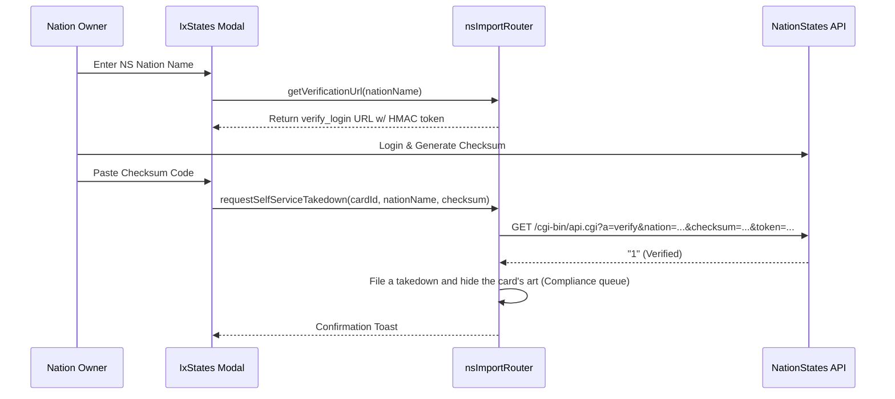

# NationStates Integration

**Last updated:** 2026-10-17  
**Status:** Release Candidate (platform 1.4.0)  
**Hierarchy:** Sub-system of IxCards / IxVault (`IXVAULT_VERSION = 3`).

The NationStates (NS) integration allows users to import their existing NationStates card collections and synchronize NS cards into the IxStates card ecosystem. It operates in strict compliance with NationStates API rate limits, daily dump guidelines, and copyright policies.

---

## Architecture & Features

- **Card Dump Sync**: Admin-triggered region syncs (`cards.admin.nationstates.*`, `/admin/cards` → Imports → NationStates, `src/server/modules/cards/cards.ns-sync.ts`) that ingest the per-season Trading Cards dump (`cardlist_S{season}.xml.gz`, published once per season, not daily) via `processRegionCardsFromDump()` in `src/lib/nationstates/sync-processor.ts`. A sync writes its progress to its `SyncLog` after every card, so it pauses, resumes and stops; every card it creates waits in Curation. There is no scheduled sync job.
- **Collection Import**: Verify NS nation ownership (`nsImport.requestVerification` → `checkVerification`, backed by `NSVerification`) and import deck cards into `CardOwnership` (`nsImport.importDeck`, `/vault/import`); imports earn an `EARN_BONUS` of 50 IxC per newly imported card (cap 5,000), paid once per nation whichever account imports it (`ns-import/decks.ts`).
- **Streaming Image Proxy (`/api/proxy-ns-image`)**: Server-side proxy restricted to nationstates.net / Wikimedia hosts, 24h cache, and a placeholder redirect when NS blocks the request — no persistent binary disk writes.
- **Attribution Footer (`NationStatesAttribution.tsx`)**: Pinned footer inside `CardDetailsModal` displaying clear fan-site attribution copy and a takedown trigger.
- **Self-Service Takedown Verification**: Nation owners verify identity via HMAC-MD5 token to hide their card's art at once through the one Compliance queue (`selfServiceTakedown`, `src/server/modules/cards/cards.compliance.ts`); an admin's restore puts the art back.
- **Rate Limit Compliance**: `nsApiClient` (`src/lib/nationstates/api-client.ts`) spaces all outgoing requests by at least 800ms (NS limit: 50 requests / 30s); dump downloads retry with backoff (`withRetry`).

### Deck import

`nsImport.importDeck` (`ns-import/decks.ts`) runs the whole import in one transaction: if anything fails, nothing is added. Each NS card is claimed once ever per nation in the ledger (`ns_import_ledger`, model `NSImportLedger`, unique `(nsCardId, nsSeason, nation)`), whichever account imports it first; importing a deck again adds only the cards that nation had not imported before. Copies are minted through `mintCopy` into the NationStates system realm (`nationstates`), and the `EARN_BONUS` is paid only for newly minted copies. The NS facts (nation, region, category, season, bank value) sit in `metadata.nsData` (`src/lib/cards/ns-facts.ts`); NS cards have card type `NS` and no lore category.

---

## Verification & Takedown Protocol

---

## Routers & Files
- `src/server/api/routers/ns-import/` (`index.ts`, `verification.ts`, `decks.ts`, `cards.ts` [verification URL, self-service takedowns, the player's NS cards])
- Region syncs and the CTE filter: `cards.admin.nationstates.*` (`src/server/api/routers/cards/admin/nationstates.ts`, `src/server/modules/cards/cards.ns-sync.ts`); takedown review: `cards.admin.compliance.*`
- `src/lib/nationstates/` (`api-client.ts`, `sync-processor.ts`, `import-service.ts`)
- `src/app/admin/cards/imports/ns/` – Imports → NationStates admin
- `src/app/api/proxy-ns-image/route.ts` – Image proxy
- `src/components/cards/display/NationStatesAttribution.tsx` – Attribution footer
- `src/components/cards/display/CardTakedownVerificationModal.tsx` – Takedown dialog (also `src/app/settings/_components/modals/NSTakedownModal.tsx`)
- `src/components/cards/display/nationstates-api.md` – Reference copy of the upstream NationStates API documentation

---

## Related Documentation

- [IxCards System Guide](./cards.md)
- [MyVault System Guide](./myvault.md)
- [API Reference: IxVault (Cards & Credits)](../reference/api-complete.md)
