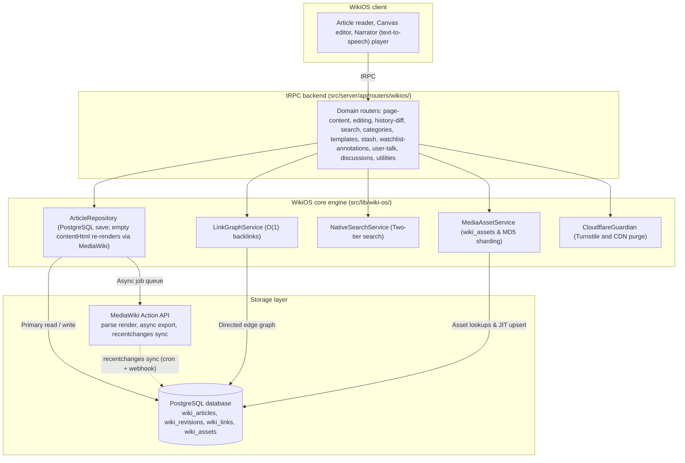

# WikiOS native architecture

**Last updated:** 2026-10-25 (launch hardening: conflicts, classic authority, sister wikis, proof)
**Launch shape:** WikiOS is the wiki inside IxStates (ixwiki.com/projects/ixstates); ixwiki.com stays classic MediaWiki,
public and editable, and canonical and share URLs stay on classic. WikiOS v1 (PR #52, D20) is merged and ships switched
off; the launch turns `WIKIOS_V1_ENABLED` on (step 6b of the [launch runbook](../../operations/wikios-v1-cutover.md)). The
ixwiki.com takeover is deferred. See [Launch shape and modes](#launch-shape-and-modes).  
**Status:** Release candidate, platform 1.5.0  
**Package:** `src/lib/wiki-os/` (in-repo module, imported as `~/lib/wiki-os`; not a published package)  
**Runtime:** TypeScript 7.0, Next.js 16 App Router  
**Versions** (`src/lib/buildVersion.ts`): WikiOS app `WIKIOS_VERSION = 1`; Canvas editor `CANVAS_VERSION = 1`; Stash
`STASH_VERSION = 1`; Image Repository `REPOSITORY_VERSION = 2`. Lorewards and article awards (`WikiArticleAward`) are
versioned with Achievements. The launch hardening moves none of them (owner question: `WIKIOS_VERSION` at launch).  
**Routes:** `/wiki/*` (one catch-all route: the reader, `?action=edit`, `?action=history`, `Talk:` pages, `?source=` foreign-wiki pages), `/util/*` (utility pages, including
`/util/repository` and `/util/lorewards`), `/stashes`  
**Related:** [style guide](style-guide.md) · [Margin spec](wikios-margin-spec.md) ·
[Stage 3 config plan](wikios-stage3-config-plan.md) (superseded) · [Stash](../stash.md) · [Lore lifecycle](../lore-lifecycle.md) ·
[gold proof reports](../../audits/wikios-proof/README.md) · [launch hardening spec](../../superpowers/specs/2026-10-24-wikios-launch-hardening-design.md)

WikiOS is the knowledge engine and structured worldbuilding platform for IxStates. PostgreSQL is the primary database for article content (4,685+ articles), append-only revisions, directed link graphs (48,200+ edges), taxonomies, and 7,555+ media assets (`wiki_assets`). Saves commit to PostgreSQL first (target under 10ms); rendering still goes through MediaWiki (see below).

---

## Launch shape and modes

The owner chose the launch shape on 2026-10-24 ([launch hardening spec](../../superpowers/specs/2026-10-24-wikios-launch-hardening-design.md)).
IxStates stays at ixwiki.com/projects/ixstates (`BASE_PATH=/projects/ixstates`) and WikiOS is its wiki. ixwiki.com stays
classic MediaWiki, public and editable. Canonical and share URLs point at classic, and IxStates' robots rules cover only
its own paths and keep `?source=` pages out of the index. Bots move to WikiOS's `/w/api.php` with signed bot passwords
(runbook step 6c), and their edits mirror out to classic. The takeover kit (the standalone `wikios` process,
`wikios-takeover.conf`, the `/classic/` article path) is deferred: its MediaWiki parts apply only with
`define( 'WIKIOS_TAKEOVER', true )`, which nothing in the launch sets, and its steps are the deferred section of the
[launch runbook](../../operations/wikios-v1-cutover.md).

Two switches decide what WikiOS does: `WIKIOS_V1_ENABLED` (`src/lib/wiki-os/v1-switch.ts`) and the admin editing switch
(`src/lib/wiki-os/editing-switch.ts`, in `/admin/wikios-settings`). The inbound sync from classic and the conflict rule
below run in every mode.

| Mode | Writes | Mirror to classic | v1 readers: background renders, indexed search, lore cards, the Lorewards sync |
|---|---|---|---|
| Off (`WIKIOS_V1_ENABLED` off, the default) | Reads only. Writes follow the editing switch, which is off by default: refused with `readonly`, and `/w/api.php` answers `readonly` | Idle once its queue drains | Off: renders do nothing, search uses the older query, and lore cards and Lorewards read IxWiki from MediaWiki |
| Editing switch on, v1 off | On: edits, uploads, `/w/api.php` | On | Off, as above |
| v1 on (the launch mode) | On | On | On, from WikiOS's tables. The admin switch is redundant in this mode |

Turning editing on in either way refuses writes until the protections import has run: the rights import of runbook
step 1b writes the marker it waits for, after checking step 1's backfill.

### Conflicts with classic

Both wikis stay editable, so both can change a page from the same base. The later save, by its actual save time on its
own wiki, stands on both wikis; a tie within the same second goes to classic, and imports, undeletes and restores count
at the moment they happened. This covers edits, deletes, moves and undeletes. One decision function,
[`services/conflict-rule.ts`](../../../src/lib/wiki-os/services/conflict-rule.ts), judges every collision, inbound and
outbound, so the mirror and the inbound cycle always agree. Nothing is overwritten silently. Every overwritten editor
is told:

- an in-app notice (and a Discord DM when their account is linked) with the diff and a "Restore my text" button that
  saves their text as a new edit;
- a short note on their classic user talk page;
- an edit-summary trail on the winning revision, on both wikis.

Each collision is one row of the Conflict log in `/admin/wikios-settings`, and the overwritten revision stays in both
histories. This replaces "park". A revert or rollback saves on top of the head the editor read, so an edit that landed
meanwhile makes it an edit conflict (`services/revert-service.ts`). Saves have their own rate limit per group
(`services/save-rate-limit.ts`). An inbound step that keeps failing is quarantined so the sync moves on, and a mirror job
that fails eight times is dead; both have admin tools. The operator's view, with the known limits, is runbook step 10d.

### Classic authority

Classic is the authority for blocks, user groups and `MediaWiki:` interface messages. The rights import (runbook
step 1b, `scripts/wikios-import-rights.ts`) brings classic's groups, protections and blocks over once, and the inbound sync then
applies classic's block and rights log events (`services/inbound-log-events.ts`). WikiOS refuses every save to a
`MediaWiki:` page, a system save included (`services/edit-service.ts`), and an XML import into WikiOS accepts only a dump
of classic itself (`xml/import-origin.ts`), since anything else would never mirror. Whether the unused
`editsite*` and `editinterface` rights stay in the group table is an open owner decision.

### Sister wikis

IIWiki and AltHistory are other people's wikis, read where they live. `http-reader.ts` reads them (through the
maps.ixwiki.com relay in development), and a sister page is rendered by its own wiki (`action=parse&oldid=`, see
[mediawiki-dependencies.md](mediawiki-dependencies.md)). A country of another wiki (an Eurth nation on IIWiki) reads its
own page there everywhere: the dossier, the map panel, the profile's lore and the `countries.getWiki*` readers
(`src/server/modules/countries/countries.wiki.ts`). On a `?source=` page, links stay on that wiki, and editing, Watch,
`?margin` and the Halo follow the page's wiki. Searching with `wikiSource: "all"` queries all three wikis and is best
effort: an unreachable sister adds no results. Sister reader pages are not indexed. The pieces:

- **Guard** ([`upstream-guard.ts`](../../../src/lib/wiki-os/upstream-guard.ts)): every outbound wiki API call goes
  through a per-host breaker (five failures in a row open it for 30 s, then one probe) and a limiter (8 in flight,
  240 a minute; the public api.php proxy has its own smaller lane). A failure is a typed `WikiUnavailableError`, which the
  reader, previews and search show as "IIWiki could not be reached just now", never as "not found" or an empty list.
- **Sanitizer** ([`sanitize-sister-html.ts`](../../../src/lib/utils/sanitize-sister-html.ts)): the trust boundary for a
  sister wiki's HTML. Images load only through the media proxy, no style may leave the article, app class names and ids
  are stripped or prefixed, and the article sits in its own contained box.
- **Link rule** ([`wiki-link-target.ts`](../../../src/lib/wiki-os/wiki-link-target.ts)): an absolute link to an article
  on any wiki WikiOS reads (IxWiki, iiwiki, althistory) opens in the in-app reader with `?source=`, from IxWiki pages and
  sister pages alike; a link with a query string stays where it points. The composer, Discord markdown, admin link tools
  and media search carry the source, and hover previews work for sister pages.
- **`Template:Sister` embed**: `{{Sister|iiwiki|Title}}` (optionally `section=`, `infobox=yes` or `card=yes`) is plain
  wikitext on both wikis, so it round-trips and mirrors unchanged. Classic renders it as a small link box ("From iiwiki:
  Title"; runbook step 3d creates the template). WikiOS embeds the real page live: the reader asks `wikios.sisterEmbed`
  for each box, and `getSisterEmbed` caches each embed for an hour (one read in flight per page). Cached embeds count
  only against the `sisterwiki` bucket; an embed that has to be read from the sister wiki costs it up to two calls, so
  those reads have a per-caller limit of their own, 20 a minute (60 signed in).
- **Size limits**: a sister wiki's answer is read up to 16 MB (`MAX_SISTER_RESPONSE_BYTES`; refused by
  `Content-Length` or cut off once the stream passes it) and then fails as "could not be reached"; a render that big is
  cached as unrenderable. The sister render cache holds at most 64 MB (`RENDER_CACHE_BYTES`, two bytes a character).

### Proof and gates

Gold is measured, not asserted. `scripts/audit/wikios-proof.ts` runs the three harnesses (the editor round trip, render
parity with MediaWiki and the bench) under a profile (local, launch or recurring) and checks their reports against
`scripts/audit/wikios-proof-thresholds.json`. Its summary is keyed to a hash of the WikiOS source it measured. The
committed proof (`docs/audits/wikios-proof/latest.json`) gates every deploy: `deploy-production.sh` runs the `predeploy`
check, which refuses a release whose WikiOS code changed since the committed passing proof, or whose editor round trip
changes a byte of the production corpus. The weekly `wikios-proof` cron job runs the recurring profile on the server.
Numbers: first report pending. How to run it, each threshold and the ratchet rule:
[docs/audits/wikios-proof/](../../audits/wikios-proof/README.md).

---

## Architectural highlights

- **PostgreSQL primary storage.** Writes commit in under 10ms directly to `wiki_articles` and `wiki_revisions`.
- **`contentHtml` cache.** `contentHtml` is served when present, but `ArticleRepository.saveArticle` writes an empty string unless the caller supplies HTML, so the next read re-renders through MediaWiki `action=parse`; reads also call MediaWiki for author data (cached). There is no measured sub-2ms, no-PHP read path.
- **Relational link graph (`wiki_links`).** Stores directed edges for indexed backlink queries and identifies red links without extra lookups.
- **Native Media & Asset Engine (`MediaAssetService`, plan 411).** Manages the media records in `wiki_assets` (`md5Hash` hashes the filename for MediaWiki's shard path, `sha1` the content). Uploads are native: `services/upload-service.ts` checks the bytes (type sniffed from the first bytes, size, SVG safety), stages them under their SHA-1 in `WIKIOS_UPLOAD_DIR`, serves them at once from `/api/wiki/file/<name>`, creates the `File:` page and queues an `upload` mirror job (`services/mirror-upload.ts`) that sends the same bytes to MediaWiki and then switches the asset to its `/images/` path. No asset row is invented for a name that was never uploaded or fetched. **BlurHash (WK-17):** an upload's BlurHash is computed from its own pixels (`services/image-blurhash.ts`, sharp: PNG, JPEG, GIF and WebP only, a 32 px thumbnail, bounded by `getMaxImageArea` and a 5 s timeout; best effort, so a file that cannot be decoded still uploads with none, and an SVG or PDF never has one) and stored in `wiki_assets.blurhash`; `BlurHashService` (`core/blurhash-service.ts`, no dependency) encodes and decodes the format and draws a hash as a small blurred SVG (`placeholderDataUri`). The `File:` page's image and the editor picker's IxWiki tiles show it behind the picture until it loads (`shared/PlaceholderImage.tsx`); an asset with no hash falls back to the size-only box (`createPlaceholderSvg`). A file re-registered from MediaWiki with a new size loses its old hash. Assets stored before WK-17 get theirs from `bun run wiki:backfill:blurhash` (dry run, then `-- --apply`; `services/blurhash-backfill.ts`: staged uploads are read from the staging directory, others through `downloadMedia`'s host allowlist and 10 MB cap).
- **No direct MariaDB connection.** The MariaDB pool (`mysql-pool.ts` / `mysql-reader.ts`) was removed on 2026-08-25 (`80eee985d`). Bridge reads are PostgreSQL (`bridge/pg-*.ts`) plus the MediaWiki HTTP Action API.
- **Inbound recent-changes sync.** `services/auto-sync-service.ts` (`runAutoSyncCycle`) pulls edits made directly on classic MediaWiki into PostgreSQL, from the `wiki-recentchanges` cron job and the `/api/wikios/inbound-sync` webhook.
- **Outbound mirror (`services/mirror-worker.ts`, plan 407).** A durable outbox (`wiki_mirror_jobs`, written in the same transaction as the edit, move, delete, undelete or protection) applied per title in order by the dedicated `WikiOSMirror` bot: revisions go through `action=import` with `assignknownusers=1`, so MediaWiki credits the author's first shown claimed old IxWiki name, and anyone else's edit goes out as `wikios>handle`; failures back off and end `dead` after 8 attempts for an administrator to requeue.
- **Multi-wiki reader.** `?source=iiwiki|althistory` opens another wiki's page read-only (Sept 2026); see [Sister wikis](#sister-wikis).
- **Article sanitizer (`src/lib/utils/sanitize-html.ts`, plan 415).** `sanitizeWikiArticleHtml` keeps the tags and attributes MediaWiki's own Sanitizer allows (legacy `{| border=1 bgcolor=… |}` tables, `<font>`, `<center>`, `<del>`/`<ins>`, ruby, `<bdo>`, `<data>`, list `type`/`start`/`reversed`) and blocks scripts, frames, forms, event handlers and `javascript:`/`data:` URLs. A `<style>` stays only when it is TemplateStyles' own (`data-mw-deduplicate`), and then as CSS confined to `.mw-parser-output` by `scope-template-styles.ts`: the reader gives that class, MediaWiki's own, to each element whose innerHTML is a part of the article (body, infobox, notices, the editors' previews), so a template's CSS never reaches the header, toolbar or margin around it; a selector that asks for the root's siblings is dropped, only `@media` at-rules survive, and `@import`, a `url()` to any host but the wiki's own origin (relative URLs stay), `attr()`, `expression()`, `behavior` and `-moz-binding` are stripped; anything the splitter cannot read with certainty is dropped. `WIKIOS_TEMPLATESTYLES=0` is the emergency lever: it removes every `<style>` again (on when unset, empty, `1`, `true`, `on` or `yes`, off for any other value; part of the sanitizer fingerprint; runbook step 10c in [wikios-v1-cutover.md](../../operations/wikios-v1-cutover.md)). The scoper is tested against an exact oracle (lightningcss): `bun run audit:template-styles` for a deep run.
- **Cloudflare edge defense (`src/lib/wiki-os/guardian/`).** Non-blocking Cloudflare Zone edge cache purges on save
  (not on revert or rollback). There is no CAPTCHA step (plan 416 removed the unused Turnstile check): editing needs a
  signed-in account and is rate-limited and rights-checked. There is no mass-blanking or homoglyph abuse filter; the
  editor client blocks saves that lost content.
- **Canvas visual editor (`CANVAS_VERSION = 1`).** Plate-based block editor (Plan 206) with a WikiAST ↔ wikitext converter (Plans 205/208) and lossless template serialization (Plan 301).

---

## Engine details

- **Edit policy.** `checkEditPolicy` (`src/lib/wiki-os/namespace-policy.ts`) lets signed-in users edit Main and the
  talk namespaces, plus their own user space: the `User:` pages of their passport handle and of their approved old
  IxWiki names, and their subpages (not `.js`, `.css`, `.json` or `.less` subpages). Every other namespace is admin-only; Special and Media are never editable. Page protection can't
  be set yet.
- **Identity (IxnayID plan A).** Every edit is signed with the editor's passport handle (`requireWikiAuthorName`,
  `src/lib/wiki-os/auth.ts`): a save, revert, rollback or upload without one is refused, and the editor asks a
  handle-less player to pick one before their first save (`HandlePickerDialog`). Old IxWiki names reach an account only
  through approved name claims, read through one resolver (`src/lib/identity/wiki-names.ts`); an approved claim tags
  the name's unauthored revisions with the account, and imported and inbound-synced revisions are tagged the same way
  after they are stored. A root `User:` page of a handle or a shown claimed name redirects to the owner's passport;
  bot passwords log in as `handle@App`, with claimed names as aliases. See
  [Wiki identity](../ixnayid-passport.md#wiki-identity).
- **Search scoring.** Spotlight autocomplete (`NativeSearchService`) is a case-insensitive Prisma `contains` on titles
  that scores exact titles 1.0, prefixes 0.8 and other matches 0.5; it is not typo-tolerant, and there is no
  `pg_trgm` extension or GIN index on `wiki_articles`. Deep search builds a weighted `tsvector` query with snippets at
  query time, with no index behind it.
- **Infobox-first images** (`transformers/image-url.ts`). Lead images come from infobox parameters (`| logo =`,
  `| image =`, `| flag =`, `| coat_of_arms =`) in the stored wikitext (`extractLeadImageFromWikitext`).
  `isNoticeOrUtilityIcon` skips maintenance and construction badges, and URLs are normalised to `Special:FilePath`.
- **Main page** (`components/wiki-os/reader/WikiOSMainPage.tsx`). Two header layouts, `editorial-masthead` and
  `sculpted-emblem`, a featured-image hero, a daily rotation of statistics articles from
  `Category:Bureau of International Statistics`, and a shuffled deck of featured countries.
- **Drafts.** `src/lib/wiki-os/editor/draft-store.ts` autosaves client-side drafts under
  `wikios_draft:${source}:${title}`.
- **Export switch and bot.** `SKIP_MEDIAWIKI_SYNC=true` stops the export worker. Upstream edits use the bot in
  `WIKIOS_MEDIAWIKI_BOT_USER` (default `Heku@WikiOS`, a bot password on a personal account); there is no dedicated
  bridge account.
- **Sister wikis.** See [Sister wikis](#sister-wikis) above: the guard, the sanitizer, the link rule and
  `Template:Sister`.

---

## System topology



---

## Directory layout (`src/lib/wiki-os/`)

```
src/lib/wiki-os/
├── index.ts                   # Root barrel export
├── config.ts                  # The one config object (`wikiosConfig`) and the URL helpers (plan 415)
├── types.ts                   # Nominal contracts
├── auth.ts                    # User identity and role resolution
├── use-wiki-auth.ts           # React client hook for authentication
├── storage.ts                 # Context and country resolution
│
├── page-ref.ts                # Page reference (title + wiki source) helpers
│
├── core/                      # PostgreSQL domain services
│   ├── article-repository.ts  # CRUD repository (PostgreSQL save and read)
│   ├── link-graph-service.ts  # Directed link graph engine
│   ├── native-search-service.ts # Two-tier search service
│   ├── media-asset-service.ts # wiki_assets registry (+ blurhash-service.ts: BlurHash encode/decode, placeholders)
│   ├── wiki-ast.ts            # IxWiki AST block model (+ wiki-ast-guards.ts)
│   └── category-service.ts    # Recursive category tree queries
│
├── guardian/                  # Security and CDN management
│   └── cloudflare-guardian.ts # Turnstile and edge CDN cache purges
│
├── adapters/                  # External service adapters
│   ├── mediawiki/             # MediaWiki compatibility layer
│   │   ├── write-service.ts   # The mirror bot's Action API calls (typed errors, XML import upload)
│   │   ├── csrf-cache.ts      # The mirror bot's login and CSRF token (no anonymous fallback)
│   │   ├── parsoid.ts         # action=parse / Parsoid render and conversions
│   │   └── bridge/            # PostgreSQL readers and federated HTTP readers
│   │       ├── pg-reader.ts   # Articles/wikitext (+ pg-search, pg-activity, pg-taxonomy, pg-site)
│   │       ├── http-reader.ts # IIWiki / AltHistory HTTP adapter with circuit breaker
│   │       ├── batch-reader.ts # Batched lookups
│   │       └── dispatchers.ts # Multi-source dispatchers
│   └── ixstates/              # Game simulation adapters
│       ├── unified-parser.ts  # Infobox indicator parser
│       └── cache-service.ts   # Database-native wiki cache
│
├── transformers/              # Content transformers
│   ├── html-transformer.ts    # HTML post-processor (Infobox, TOC, Notices)
│   ├── infobox-parser.ts      # Template tokenizer
│   └── media-theme.ts         # Theme switcher
│
├── templates/                 # Template registry, presets, tiered preview cache
├── editor/                    # Draft store, local cache, template wikitext parsing
├── wikitext/                  # Wikitext parser/serializer (links, lists, tables, templates)
└── services/                  # auto-sync-service.ts (recent-changes inbound sync)
```

---

## Features

### Reading

| Feature | Description |
|---|---|
| Article rendering | Server-side HTML transformation with infobox extraction, TOC generation, notice separation |
| Sticky TOC | Right-side table of contents with scroll-spy highlighting |
| Floating TOC pill | Compact mobile table of contents |
| Link previews | Hover any wiki link to view intro snippet |
| Image lightbox | Full-screen image viewer |
| Category breadcrumbs | Parent category hierarchy above article title |
| Infobox and map | Infobox tables displayed alongside embedded IxWorld map views |
| Client navigation | Page navigation handled via Next.js router without full reloads |
| Custom main page | Dashboard stats, featured article, category grid, country cards |
| Simulation embeds | Inline economic data blocks and country location maps |

### Editing

| Feature | Description |
|---|---|
| WikiOS Canvas | Dual-mode writing environment with visual block editing, source mode, live preview, and templates |
| Visual editor | Plate (`platejs`) block editor with headings, tables, images, atomic template/infobox blocks, and links |
| Source editor | CodeMirror 6 editor with wikitext syntax highlighting and active line indicator |
| Action toolbar | Save, Cancel, and Preview action buttons |
| Keyboard shortcuts | `Ctrl+B` (bold), `Ctrl+I` (italic), `Ctrl+K` (link) |
| Template insertion | Slash-command menu with template presets (Plan 207), TemplateData-driven parameter forms (Plan 302), and tiered preview cache (Plan 303) |
| Image search | `ImageSearchGrid`: the IxWiki tab searches IxWiki's files (`wikios.searchFiles`, each tile with its BlurHash placeholder); the Commons tab searches Wikimedia Commons (`commons.search`, through `editor/hooks/useCommonsImageSearch.ts`: debounced, 2 characters minimum, pages of 30 with "Load more", images only, no automatic retry so a spent `commons` rate-limit bucket is not drained further) and shows each file's licence and author, with a link to its Commons page. A Commons file is inserted as `[[File:Name]]` like an IxWiki one (IxWiki shows it through InstantCommons). Searching works with `WIKIOS_V1_ENABLED` off |
| Mode toggle | Switch between visual and source editor modes |
| Edit summary | Summary input field and minor edit checkbox |
| Rollback | Undoes the last editor's consecutive edits by saving the older text as a new edit through the one save path, on top of the head the editor read: an edit that landed meanwhile makes it an edit conflict (`services/revert-service.ts`) |

### Margin and discussions

WikiOS Margin is an inspector docked to the reader, on top of MediaWiki-style talk pages: `Talk:<title>` and every `<ns> talk:` page are ordinary wikitext pages (the reader's Page / Discussion tabs link the pair, "Add topic" opens the editor on a new section), and Margin stays an extra anchored layer on the subject page.

| Feature | Description |
|---|---|
| Split-canvas drawer | Slide-over panel docked to the right margin |
| Discussion threads | Section-anchored and page-wide threads with author roles and reply trees |
| Text markup | Multi-color text highlights with jump-to-text navigation |
| Stash integration | Quote clips and personal bookmark management from the reader |
| Selection capsule | Context menu on text selection with Highlight, Discuss, and Stash actions |
| Gutter pins | Margin indicators showing discussions and annotations next to headings and paragraphs |
| Hold-to-resolve | Hold action button to resolve discussions or record consensus |
| Margin deep link | `/wiki/<title>?margin=threads` opens Margin on the subject page; the talk page is `/wiki/Talk:<title>` |

### Stash (Collections)

| Feature | Description |
|---|---|
| Collections | Up to 25 color-coded, named collections |
| One-click stash | Stash button on every article and inside Margin drawer |
| Annotations | Text highlights on saved articles with color tags and comments |

### Lorewards (Contribution scoring)

| Feature | Description |
|---|---|
| Daily awards | Scored daily winner and runner-up based on edit size and quality |
| Leaderboards | Filterable by daily, weekly, monthly, and all-time periods |
| Streak calendar | Calendar heatmap showing consecutive contribution days |
| Today's race | The top ten editors of the current UTC day, scored live (`lorewards.getTodayRace`, cached 10 minutes) |
| Payouts and trophy cards | Tiered IxCredits by contest and place and a one-of-one trophy card per recorded place; see [achievements.md](../achievements.md#lorewards) |
| One view, two homes | `/util/lorewards` (WikiOS, `LorewardsView focus="contest"`) and the Vault's Lorewards tab; the passport modal and the article badge (`?user=<winner>`) open the same view |
| Nav entry | **Lorewards** in the wiki section of the navigation, after Repository (`src/lib/navigation/app-sections.ts`), opens `/util/lorewards` |
| Margin race chip | The reader's margin drawer ends with today's race in one line (`MarginRaceChip`): the viewer's place and score (`lorewards.getMyRace`, signed in) and the leader, linking to `/util/lorewards`; neither read runs while the drawer is closed |
| User stats | Total wins, runner-up finishes, bytes contributed, current and longest streaks |
| Scoring engine | Evaluates bytes added, prose ratio, edit depth, novelty and topic importance (`lib/lorewards/scoring.ts`); admins tune the weights in Admin → Wiki → Lorewards (`lorewardWeight_<field>`) |

### Search

| Feature | Description |
|---|---|
| Full-text search | PostgreSQL `tsvector` queries across article content and infoboxes |
| Snippet highlights | Results include context snippets with match markers |
| Namespace filter | Filter by articles, categories, or templates |
| Spotlight overlay | `Cmd+K` palette; title search is a case-insensitive `contains` (not trigram, no GIN index) |

---

## API endpoints

### WikiOS router (`src/server/api/routers/wikios/`)

**Page content** (`page-content.ts`):
`getArticleHtml`, `getWikitext`, `getIntro`, `getInfobox`, `getPageImages`, `getArticleThumbnails`, `getArticleAuthors`, `checkPageExists`, `getMissingPages`, `resolveWikiPlaceholders`, `downloadFile`

**History** (`history-diff.ts`):
`getHistory`, `getDiff`, `getRevisionContent`

**Search** (`search.ts`):
`search`, `searchArticles`, `searchPages`, `searchFiles`, `searchBusinesses`, `advancedSearch`, `getRecentChanges`, `getRandomPage`, `getSiteStats`

**Categories** (`categories.ts`):
`getCategories`, `getCategoryMembers`, `getCategoryTotalCounts`, `getParentCategories`, `getSubcategories`, `searchCategories`, `autocompleteCategories`

**Editor** (`editing.ts`):
`previewWikitext`, `saveWikitext`, `revertToRevision`, `rollback`, `restoreArticle`. File uploads are not a tRPC call: they go through `POST /api/wiki/upload` (the raw file as the request body, plan 411) and api.php's `action=upload`, both ending in `services/upload-service.ts`.

**Templates** (`templates.ts`):
`searchTemplates`, `getTemplateData`, `getTemplatePreview`

**Stash** (`stash.ts`):
`getStashes`, `createStash`, `updateStash`, `deleteStash`, `stashPage`, `unstashPage`, `isStashed`, `getStashItems`

**Watchlist and annotations** (`watchlist-annotations.ts`):
`getWatchlist`, `getWatchlistFeed`, `isPageWatched`, `watchPage`, `unwatchPage`, `markAllWatchedVisited`, `addAnnotation`, `deleteAnnotation`, `getAnnotations`

**Users** (`user-talk.ts`):
`getUserInfo`, `getUserContribs`, `getBacklinks`

**Discussions** (`discussions.ts`):
`getArticleMarginData`, `createThread`, `postComment`, `resolveThread`, `deleteThread`

**Maintenance** (`utilities.ts`):
`getOrphanArticles`, `getDeadEndArticles`, `getBrokenRedirects`, `getLongestArticles`, `getShortestArticles`, `getArchivedArticles`, `getAuditLogs`, `getHealthTelemetry`

**Sister wikis** (`sister.ts`):
`sisterEmbed` (see [Sister wikis](#sister-wikis))

### Wiki cache router (`src/server/api/routers/wikiCache.ts`)

`getCountryProfile` reads a country's wiki profile through the database-native cache (`services/cache-service.ts`). It
is public on the rate-limited bucket, the name is capped at 255 characters, and a page the wiki says it does not have is
remembered for two minutes in a cache of its own. `refreshCountryCache` drops a cache entry and is admin-only.
